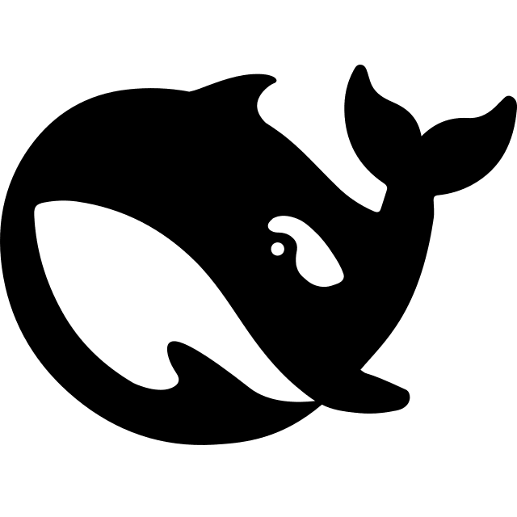

<p align="center">
  
</p>

<h1 align="center">dsh-turn-notifier</h1>

<p align="center">
  Inspired by Codex's <code>agent-turn-complete</code>: send the final reply summary to the macOS Notification Center when a turn ends.
</p>

<p align="center">
  <a href="README.md">中文</a> · English
</p>

<p align="center">
  
  
  
  <a href="https://github.com/Xm-Coding/dsh-turn-notifier"></a>
</p>

A macOS Host plugin for [DeepSeek Harness](https://github.com/deepseek-ai/deepseek-harness). When a turn in the current session finishes, you receive a system notification with a summary of the final reply.

> **macOS only.** Requires DeepSeek Harness `0.2.1-rc.2` through `0.2.x` and Node.js `>=24.9`; the runtime bundled with the desktop app satisfies this. The notification helper includes both Apple Silicon and Intel executables, so Xcode and `terminal-notifier` are not required.

## Current capabilities

- ✅ One notification per turn, with the final assistant reply summary in the body.
- ✅ Native notification with the DeepSeek icon; the native helper uses legacy `NSUserNotification`, with an AppleScript app as fallback.
- ✅ The native helper keeps the notification in Notification Center after 10 seconds instead of deleting it; how long the on-screen banner stays is controlled by macOS notification settings.
- ✅ **Session opening path fixed**: the Host records the session associated with the notification, and the Client dynamically injects `remote.turnNotifier`, claims the action, and calls `uiWorkspace.openSession`. `registerClient`/`claimAction` have been verified in a real headless GUI.

## ✨ Features

- 🔔 **A true turn-completion notification**: wait for Harness to emit `turn/end`; notify after the turn ends.
- 💬 **Read the reply in the notification**: the body is the text of the last assistant message in the turn; the subtitle shows the completion status and session title (or the current working directory name when there is no title).
- 🐋 **DeepSeek icon**: notifications use the native helper bundled with the plugin; the plugin manager and notification icon stay consistent.
- 🤫 **Quiet by default**: subagents, cancellations, and errors do not notify unless enabled.
- 🔊 **Configurable sound and body**: system sounds, silence, body length limits, and status-only notifications without reply text.
- ⏱ **Kept in Notification Center**: the native helper performs a retention check after 10 seconds and does not delete delivered notifications; when the system banner collapses is controlled by macOS.
- 🌐 **Chinese and English copy**: status, error, and cancellation copy comes from `locale/` and can be selected with `locale: auto | zh | en`.
- ♻️ **Bounded delivery retry**: transient send failures retry up to 3 times with 1/2/4-second backoff; deterministic errors such as a missing helper or unsupported platform are not retried.
- 🔒 **Local processing**: no network requests, no telemetry, and no notification body stored by the plugin.

## 🚀 Installation

### Install from GitHub (recommended)

**Official desktop app (`desktop` profile):**

```bash
dsh plugin --profile desktop add github:Xm-Coding/dsh-turn-notifier
```

**Regular `dsh web`:**

```bash
dsh plugin --profile web add github:Xm-Coding/dsh-turn-notifier
```

**Custom profile:**

```bash
dsh plugin --profile <profile> add github:Xm-Coding/dsh-turn-notifier
```

You can also add `github:Xm-Coding/dsh-turn-notifier` from the DSH plugin page, or paste the repository URL directly.

> GitHub access is required during installation. If the plugin does not take effect immediately, fully quit and reopen Harness.

### Local development install

Clone the repository, then install the local directory with `link:` so source changes can be debugged immediately:

```bash
git clone https://github.com/Xm-Coding/dsh-turn-notifier.git
cd dsh-turn-notifier
dsh plugin --profile desktop add link:/absolute/path/dsh-turn-notifier
```

> `link:` is a linked install: do not move, rename, or delete the source directory afterward. For an independent copy, change `link:` to `file:`; a copied install does not sync source updates automatically.

### Allow system notifications

If the plugin does not take effect immediately after installation, fully quit and reopen DeepSeek Harness.

The native helper uses legacy `NSUserNotification`, so macOS may not show a permission prompt. If you do not see notifications, open **System Settings → Notifications → DeepSeek Notifier**, make sure notifications are enabled, and choose banners or alerts and enable sound as needed. The AppleScript fallback app also uses the name **DeepSeek Notifier**.

## 🔔 Notification behavior

A typical notification looks like this:

> **DeepSeek Harness**<br>
> **Turn complete · Install notification plugin**<br>
> The plugin is installed and the notification path has been verified. You will now receive a notification at the end of every turn.

The subtitle uses the Harness session title, truncated after 60 characters; if the session has no title or `showSessionTitle: false` is set, it shows the current working directory name (the directory after any in-session directory change).

| What happened | Notify by default? |
| --- | --- |
| Turn completed normally | ✅ The body is the final assistant reply summary |
| Turn reached its output limit | ✅ The subtitle shows “Turn reached output limit” |
| Streaming output or tool calls in progress | No; wait for the turn to finish |
| Subagent completed | No by default; enable with `includeSubagents` |
| Turn stopped manually, by a parent task, or by a hook | No by default; enable with `notifyOnCancel`; the subtitle distinguishes the stop reason and the body does not include intermediate replies from before the stop |
| Stop caused by closing the session or quitting Harness | No |
| Turn failed | No by default; enable with `notifyOnError`; the body shows the error instead of intermediate replies from before the failure |

The body keeps at most **240 Unicode characters** by default; longer replies are truncated with `…`.

The native helper keeps the notification in Notification Center after **10 seconds** and does not actively delete it; how long the on-screen banner stays is controlled by macOS. Session opening uses `remote.turnNotifier`, dynamically injected by the Client.

## ⚙️ Configuration

The default configuration is in [`cordis.patch.yml`](cordis.patch.yml).

| Field | Default | Description |
| --- | --- | --- |
| `enabled` | `true` | Whether notifications are enabled |
| `includeSubagents` | `false` | Whether to notify for subagent sessions as well |
| `includeMessage` | `true` | Whether the body includes the final assistant text or error; when `false`, every notification shows only status |
| `showSessionTitle` | `true` | Whether the subtitle shows the session title; when `false`, it shows the current working directory name |
| `notifyOnError` | `false` | Whether to notify when a turn fails |
| `notifyOnCancel` | `false` | Whether to notify when a turn is stopped manually, by a parent task, or by a hook; closing the session or quitting Harness does not notify |
| `title` | `DeepSeek Harness` | Notification title |
| `soundName` | `Glass` | macOS sound name; an empty string means silent |
| `maxCharacters` | `240` | Body character limit; accepts `40`–`2000` |
| `locale` | `auto` | Notification copy language: `auto` falls back to Chinese, or set `zh` or `en` |

To override configuration, write the complete `config` for `dsh-turn-notifier` in the current **profile**'s `cordis.patch.yml`. An override with the same id replaces the entire configuration object, so do not write only the field you want to change.

For example, to disable sound, allow error notifications, and hide reply text:

```yaml
- id: dsh-turn-notifier
  name: 'dsh-turn-notifier'
  config:
    enabled: true
    includeSubagents: false
    includeMessage: false
    showSessionTitle: true
    notifyOnError: true
    notifyOnCancel: false
    title: DeepSeek Harness
    soundName: ''
    maxCharacters: 240
    locale: auto
```

Changes take effect according to Harness hot reload; restart once if they do not.

## 🔒 Privacy and security

- At the end of a turn, the plugin reads the final assistant message text from Harness session history by recorded sequence, truncates it in memory, and hands it to the local notification helper.
- The native helper receives the body through a temporary request file private to the profile, which is deleted after delivery; the action file is cleared after the Host reads it. The AppleScript fallback passes arguments through the process, and **never splices text into AppleScript source**.
- The plugin does not store notification bodies itself: in the Harness projection cache (`session_projcache`) it stores only the turn number, whether a message exists, and the message sequence number, never text.
- When delivery fails, the Host log records only the error category (for example `exit-code=1`, `timeout signal=SIGTERM`, or `code=HELPER_MISSING`), not the body, command line, or helper output.
- macOS may retain notification previews on the lock screen or in Notification Center. For sensitive replies, set `includeMessage: false` or adjust the system notification preview options. Session titles may also contain sensitive information; set `showSessionTitle: false` separately. With both disabled, status and the working directory name are still shown, so this is not a fully anonymous mode.
- The plugin does not use the network, upload sessions, or include third-party analytics.

## ❓ FAQ

<details>
<summary><strong>I installed it, but I am not receiving notifications.</strong></summary>

1. Confirm that it is installed in the profile you are using: usually `desktop` for the desktop app and `web` for regular `dsh web`.
2. Fully quit and reopen Harness in case the Host plugin has not been hot-reloaded.
3. Open **System Settings → Notifications → DeepSeek Notifier**, make sure notifications are enabled, and enable banners or alerts and sound as needed.
4. Check whether Focus mode is blocking notifications.
5. Check the Harness Host logs for `[dsh-turn-notifier] notification failed`. If it ends with `code=HELPER_MISSING`, rebuild the native helper:
   ```bash
   npm run build:native
   ```
   If the AppleScript fallback helper is missing, run `native/build-macos-notifier.sh`.
</details>

<details>
<summary><strong>Why does clicking a notification not open the session?</strong></summary>

Please check:

1. You have restarted Harness to load the current Client bundle.
2. The Harness Client is running and the plugin is loaded in the current profile.
3. The session associated with the notification still exists and has not expired.
4. The Client has registered with the current Host.

If the action has expired, the Client is not running, or the session no longer exists, clicking will not open the target session.
</details>

<details>
<summary><strong>How do I notify completion without showing the reply?</strong></summary>

Set `includeMessage` to `false`. The body then shows only statuses such as “Turn complete”; errors also do not show details. This is useful on the lock screen or on a shared computer.
</details>

<details>
<summary><strong>Why do source changes have no effect?</strong></summary>

A `link:` install uses the source directory directly, but Host JavaScript updates may still require restarting Harness. If you moved the source directory, uninstall first and run `add link:<new path>` from the new location. A `file:` copied install requires reinstalling to sync changes. The native helper binary also requires a Harness restart after it is rebuilt.
</details>

## 📦 Update and uninstall

After updating source for a `link:` install, restart Harness to reload the Host code and native helper. For a `file:` install, run the install command again.

To uninstall, replace `<profile>` with the profile actually in use:

```bash
dsh plugin --profile <profile> remove dsh-turn-notifier
```

Uninstalling does not delete your local source directory.

## 📄 License

[MIT](LICENSE)
