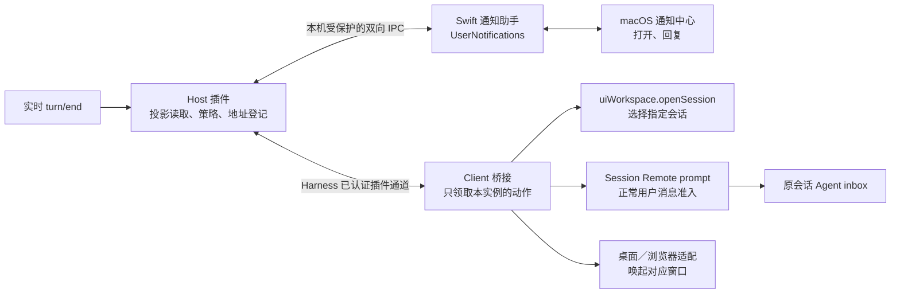

# dsh-turn-notifier 通知交互改造实施说明

> 文档状态：**部分实施**。阶段 A 的隐私修复（A4）和 Host 侧会话展示（A2-1～A2-4）已完成；点击跳转仍待验证；通知内回复已按用户要求于 2026-11-12 移除。进度以 [第 0 节](#progress) 为准，证据见 [implementation-status.md](implementation-status.md)。初次核查：2026-10-25；进度更新：2026-10-26。面向任何能够读取仓库、修改代码和运行验证的模型或开发者；不依赖此前聊天记录，也不要求执行者使用 Codex。
>
> 目标顺序：**准确定位会话 → 修复点击／显示 → 通知内回复（已移除） → 可靠性与体验**。这里的“仿照 Codex”指用户期望的交互效果，不表示已经掌握或需要复制 Codex 的内部实现。

## 目录

0. [当前进度与接手指南](#progress)
1. [目标、范围与执行规则](#scope)
2. [核查基线与源码地图](#baseline)
3. [保留功能与已确认不足](#assessment)
4. [目标架构与实现边界](#architecture)
5. [会话地址、数据与通信协议](#contracts)
6. [阶段 A：准确定位会话（P0）](#phase-a)
7. [阶段 B：修复点击／显示（P0）](#phase-b)
8. [阶段 C：通知内回复（P1）](#phase-c)
9. [阶段 D：可靠性与体验（P1／P2）](#phase-d)
10. [配置、兼容与文件改动规划](#changes)
11. [测试矩阵与发布门槛](#validation)
12. [实现代码参考](#examples)
13. [交接记录与执行清单](#handoff)
14. [官方资料与源码链接](#references)

<a id="progress"></a>
## 0. 当前进度与接手指南

本节是进度的唯一入口，最近更新：2026-10-26。每个任务的证据、源码链接和测试明细见 [implementation-status.md](implementation-status.md)。第 1–14 节保留原计划；凡被核实推翻或修正的假设，都在原处用“**2026-10-25 核实**”标注，并在 [0.4](#plan-corrections) 汇总。接手者完成任何一步后，同时更新本节的表格和 implementation-status.md。

### 0.1 状态标记

| 标记 | 含义 |
| --- | --- |
| ✅ 已完成 | 代码、自动测试与文档已落地；是否已经真机验证见“待验证”一列 |
| 🟡 部分完成 | 已完成的子项与剩余子项分别列出 |
| ⏸ 待决策 | 被 [决策 D-1](#decision-d1) 阻塞；决定之前不要开始 |
| 🔍 待验证 | 需要 macOS 真机和已安装的 Harness 才能完成，见 [0.6](#verification-queue) |
| ⬜ 未开始 | 不受阻塞，可以直接接手，见 [0.7](#next-tasks) |

### 0.2 任务状态

| 任务 | 状态 | 已完成 | 剩余工作／待验证 |
| --- | --- | --- | --- |
| A0 能力确认 | 🟡 | 对照 Harness 源码 `22ddee3` 核对了投影 handle、历史事件读取、会话标题与当前目录、Client 装配、插件自定义 remote 通道、`openSession`、`dsh://` 深链、`session.prompt`、Client 会话状态；固定源码生成 Host/Client Typert 契约；临时真实 web profile 的启动图包含 Client bundle，`/api/turnNotifier/ping` 返回 `pong` | 真实浏览器执行 Client 代码、精确导航、prompt 与 Swift action 原型仍未验证；V1–V4 未完成 |
| A1 部署身份与通知登记 | 🟡 | deploymentId、实例锁、原子写、通知记录、过期/容量/坏文件清理、路由解析已实现；真实 desktop profile 已生成 `deployment.json` 与锁 | notificationId 已作为可选参数传给当前 applet（applet 暂时忽略）；原生 identifier 与回调验证仍待 A3/B |
| A2 会话展示 | 🟡 | A2-1～A2-4：副标题为“状态 · 会话标题”，标题超过 60 个字符截断；无标题或 `showSessionTitle: false` 时显示当前工作目录名，目录取 `ctx.workingDirectory`，缺失时才用 `header.cwd`；新增配置 `showSessionTitle` | A2-5 子代理导航能力标记依赖导航实现（D-1）；真机确认（V1） |
| A3 本机桥接与客户端选择 | 🟡 | Client Remote 注册/领取/回执与 Host 动作路由、租约和 generation 校验已实现；真实临时 Web Host 已通过 `registerClient`/`claimAction` RPC | 原生 helper IPC、冷启动、窗口前置与真实浏览器动作执行仍待 B |
| A4 正文、缓存与错误处理 | ✅ | A4-1～A4-9 全部完成，实现方式与原文的差异见 0.4 第 1、4、5 条 | 真机确认（V1） |
| B1–B4 点击／显示 | 🟡 | B1 legacy helper、Host 文件桥接、Client open 路径、动态 `remote.turnNotifier` 注入、10 秒后保留检查已实现；真实 headless GUI 的 `registerClient`/`claimAction` 与 Host 端到端 open 动作通过 | 真实系统点击/窗口前置、B3/B4 尚未实现 |
| C1–C4 通知内回复 | 🚫 已移除 | 2026-11-12 按用户要求删除，不再提供 Reply 按钮、reply 动作或 prompt 注入 | — |
| D1 文案、前台状态 | 🟡 | D1-1 国际化（F12）完成：状态、错误、停止文案移入 locale 资源，新增 `locale` 配置 | D1-4、D1-5 前台抑制需要 Client 侧状态，待实现 |
| D2 投递队列与重试 | 🟡 | F9 Host 侧完成：串行队列、待投递上限 128、1/2/4 秒退避最多 3 次重试、确定性错误不重试、卸载取消定时器 | 系统投递状态、unknown 回执、helper 生命周期待原生助手实现 |
| D3 配置、诊断与发布 | 🟡 | D3-1 调研完成：schemastery 的 `Config` 需要额外的 `@deepseek-ai/schemastery` 运行时依赖；为避免再为配置 UI 增加依赖，暂不导出 `Config`，继续使用 `normalizeSettings` | 配置 schema、诊断入口、测试通知、打包检查待做；D3-4～6 待原生助手实现 |
| D4 等待用户与长任务 | ⬜ | — | 审批、用户问题、goal 连续轮次；排在主链路之后 |
| X1 applet 无参数启动 | 🟡 | 已在参数不足时改为尝试 `open dsh://open`，并在 macOS 重建；直接无参数启动退出码 0 | 点击历史通知的人工验证（V5）仍未执行 |
| X2 版本兼容声明 | ✅ | 已声明 `engines.dsh >=0.2.1-rc.2 <0.3.0`、`engines.node >=24.9.0`；README 写明范围 | 需在真实 Harness 安装/升级时验证管理器接受 |
| X3 applet Info.plist | ✅ | 构建脚本删除 `NS*UsageDescription`、设置 `LSMinimumSystemVersion=10.10`、删除旧架构键；重新构建并通过 `plutil`／`codesign` 检查 | — |

### 0.3 问题清单状态（对应 3.2 节）

| 编号 | 状态 | 说明 |
| --- | --- | --- |
| F1 | 🟡 | A1 已保存 route/deploymentId；真实 turn/end 回写与回调仍待验证 |
| F2 | 🟡 | legacy helper 已处理 open activation 并通过文件通道交给 Host；实际点击未验证 |
| F3 | 🚫 已移除 | 通知内回复已按用户要求删除；插件不再提供 Reply／prompt 注入 |
| F4 | ✅ | 关闭预览后所有原因只显示状态 |
| F5 | ✅ | 日志只记录白名单字段（`lib/diagnostics.js`） |
| F6 | ✅ | 投影不再保存正文；旧缓存的处理见 0.4 第 4 条 |
| F7 | ✅ | 出错显示错误信息或固定文案，停止显示固定文案，都不再取先前的助手文本 |
| F8 | ✅ | 显示会话标题与当前目录；会话没有标题时，同目录的多个会话仍无法区分 |
| F9 | 🟡 | Host 侧已有有界重试与队列；系统投递状态、unknown 回执仍未实现（D-1） |
| F10 | 🟡 | A3 已有 generation/租约/Client 注册；多窗口、冷启动与窗口前置仍待 B |
| F11 | 🟡 | 自动测试从 15 项增至 89 项；仍没有真实 Harness 集成测试和真机验收 |
| F12 | ✅ | 中文／英文文案来自 `locale/` 资源，新增 `locale` 配置 |
| F13 | ⬜ | 只覆盖轮次结束 |
| F14 | ✅ | 投影 handle 与旧 API 兼容已实现；版本范围已在 `package.json` 声明（X2） |

<a id="plan-corrections"></a>
### 0.4 核实后修正的计划假设

1. **历史消息读取（影响 4.3 `readMessageAt`、A4-4～A4-6）。** Harness 已禁止新代码调用 `Session.eventAt()`、`snapshotEvents()`、`ownEvents()`（Agent Note 2026-09-09）。原文“旧版 `eventAt`／`snapshotEvents`”一句不再作为可选路径。现实现为 `lib/harness-adapter.js` 的 `readAssistantTextAt`，调用异步的 `ctx.sessionQuery.readEvent({ sessionId, seq }, signal)`，并校验事件类型、轮次和序号。
2. **Host↔Client 插件通道（影响 4.1、4.2 第一行、5.3 末段、A0-2、A0-3、A3-2）。** 插件自定义的 `ctx.remote` 端点需要 typert 构建生成 `lib/typert.remote-client.*`，Client 会拒绝挂载缺少严格 codec 的端点。当前这个纯 JS、免构建的插件原本无法提供这条通道；2026-10-26 已选择 Harness 构建链，A1、A3、B、C 解除阻塞。
3. **投影新旧 API（影响 2.3 表“投影新旧 API”行）。** 升级指南把 handle API 归在 `v0.2.1-rc.2`，因此本机 `0.2.1-rc.3` 很可能已有 handle。插件在运行时检测：注册结果带 `stateOf` 就用 handle，否则退回 registry 级 `stateOf(session, key)`。实际走哪条路径待 V1 确认。
4. **旧投影缓存（影响 A4-7）。** Harness 读缓存时丢弃版本不匹配的行，并在下次为该会话写缓存时用当前 checkpoint 整体替换记录。插件不主动改写 `session_projcache`（它属于 Harness 的存储域，直接改写有并发与所有权风险），因此升级后没有再打开过的会话会保留 1.1.0 写入的旧行。README 已如实说明。
5. **停止与出错的语义（影响 A4-2、A4-3）。** `aborted` 的 `disposed`（Agent 被销毁：会话关闭、Host 退出、插件重载）一律不通知；`user`／`parent`／`hook` 分别显示，`legacy`、缺失与未知原因用通用文案；钩子给出的原因文字不显示。出错与停止的正文都不再使用助手文本。
6. **实际文件布局（影响 10.2）。** 已存在：`lib/turn-notifier.js`（监听与投递）、`lib/delivery-queue.js`（有界重试）、`lib/harness-adapter.js`（`sessionQuery`、`sessionTitle`、`workingDirectory` 的读取）、`lib/i18n.js`、`lib/diagnostics.js`。投影注册兼容（10.3）落在 `lib/projection.js` 的 `registerTurnProjection`。2026-10-26 选择构建链后已新增 `src/remote.ts`、`src/types.ts`、`client/index.ts`、`client/client.js` 与 `lib/typert.*`；尚未创建 `lib/notification-registry.js`、`lib/native-transport.js`、`lib/action-router.js` 和 Swift 源码。

<a id="decision-d1"></a>
### 0.5 决策 D-1：通知被点击或回复后由哪一侧接收

**决定（2026-10-26）：用户选择选项 1，采用 Harness 构建链。** 后续按 TypeScript + typert 生成 Remote codec、`ctx.remote.$mount()` 装配 Client 贡献，并实现 Swift 原生助手。选项 2、3 不再考虑。

实施约束（2026-10-26 核实）：npm 上的 `@deepseek-ai/dsh-typert-generator` 最新为 `0.0.1-rc.1`，与本机 Harness `0.2.1-rc.3` 不匹配；生成使用固定源码 commit `22ddee3` 的 generator，生成产物随插件发布。源码构建链可从 `api-remotes` 的 `ctx.remote.$mount()` 公开入口挂载外部贡献，不需要修改 Harness 应用本体。

| 选项 | 做法 | 对后续阶段的影响 | 选择前应先确认 |
| --- | --- | --- | --- |
| 1. 采用 Harness 构建链 | 用 TypeScript + typert 为插件生成 remote codec，按原计划实现 Host↔Client 通道与 Swift 原生助手 | A1、A3、B、C 基本按原文执行；插件不再免构建 | `@deepseek-ai/dsh-typert-protocol` 及 typert 编译插件是否发布到 npm、能否在仓库外构建；生成产物如何随插件发布 |
| 2. 改由 Client 发起 | Client 插件订阅 `ctx.uiSession.sessionStatus`，在渲染进程用 Web `Notification` 弹通知；点击时调用 `uiWorkspace.openSession`，提交走官方 `ctx.remote.session.prompt` | 不需要自定义通道、部署身份和本机 IPC，A1、A3 大幅简化；B 改为 Client 侧实现；C 的通知内回复做不到；必须有打开的客户端窗口，多窗口需去重；正文需另行读取 | 仓库外构建的 `dsh.client` bundle 能否被加载（V3）；桌面渲染进程里 Web `Notification` 的显示与点击行为 |
| 3. 上游最小改动 | 向 Harness 提交通用的插件消息通道，或由桌面壳提供通知服务（桌面壳已在更新提醒中使用 Electron `Notification`） | 取决于上游接受的接口；在合入前插件只能维持当前 Host 通知 | 与上游维护者确认接口与时间 |

决定之前，**不要**开始 A1 的部署身份与路由登记，也不要开始 Swift 原生助手。

<a id="verification-queue"></a>
### 0.6 待验证清单

以下验证需要 macOS 真机和已安装的 Harness。完成后在 implementation-status.md 记录日期、Harness 版本、步骤和实际结果，并把对应任务从 🔍 改为 ✅ 或写明失败原因。

| 编号 | 验证内容 | 步骤 | 通过标准 |
| --- | --- | --- | --- |
| V1 | 当前 Host 改动在真实 Harness 中工作 | 用 `link:` 安装或重启已链接的 Harness；在有标题的会话中跑一轮；再分别设置 `includeMessage: false`、`notifyOnError: true`、`showSessionTitle: false` 各跑一轮 | 正文是本轮最终回复；副标题为“本轮已完成 · 会话标题”；Host 日志中没有投影 `stateOf` 的弃用警告，也没有 `reply preview unavailable`；关闭预览后正文只有状态；关闭标题后副标题显示目录名 |
| V2 | 本机安装版与源码 `22ddee3` 的差异 | 记录 Harness 版本；在安装包内只读搜索 `readEvent`、`sessionProjections.register`、`sessionTitle`、`workingDirectory` | 记录每项是否存在；不存在的项写进 0.4 并调整适配层 |
| V3 | 仓库外构建的 Client bundle 能否加载并调用 `openSession`（A0-3，也是 D-1 选项 2 的前提） | 按 `dsh.client` 格式做一个只调用 `ctx.uiWorkspace.openSession` 的最小 Client 插件，`link:` 安装 | 插件被加载，两个会话之间能切换并观察到选中结果 |

> 2026-10-26：插件 `dsh-turn-notifier/client.js` 已出现在真实临时 web profile 的启动图中，Host 也能通过 `/api/turnNotifier/ping` 返回结果；浏览器实际执行和 `openSession` 仍未验证。
| V4 | Swift 原生原型（A0-5，D-1 选项 1、3 的前提） | 示例 `docs/examples/native-notification-actions.swift` 的类型检查已于 2026-10-25 通过（见 12.4）；剩下的是做最小 app：显示无敏感内容的测试通知，捕获默认点击与文本回复，验证冷启动回调与签名后的权限行为 | 真机上点击和回复的回调都能收到，进程退出后由通知中心冷启动也能收到 |
| V5 | X1：点击历史通知时 applet 的行为 | 发一条通知后不点横幅，等它进入通知中心，再点击 | 记录是否弹出 AppleScript 错误框；若弹出，按 0.7 第 4 条修复 |

> 2026-10-26：已实现参数不足时的 `dsh://open` 保护，并验证直接执行与 LaunchServices 无参数启动退出码均为 0；从通知中心人工点击仍未执行。
| V6 | 本机版本的 `dsh://open` 行为 | `open 'dsh://open'` | 仅聚焦主窗口（与 2.3 表一致）；如有变化记录下来 |

<a id="next-tasks"></a>
### 0.7 不受 D-1 阻塞、可直接接手的任务

按建议顺序排列。每项完成后更新 0.2、0.3 和 implementation-status.md。

> **2026-10-26 第二轮进度：** 第 1、2、3、5 项已完成；第 4 项代码完成、V5 人工点击待验证；第 6 项调研后按不引入依赖处理，记录在 implementation-status.md。

1. **D2 的 Host 侧投递状态（F9）。** 在 `lib/turn-notifier.js` 的投递环节加入有界重试：`HELPER_MISSING`、`UNSUPPORTED_PLATFORM` 等确定性失败不重试；退出码非零、超时按 1／2／4 秒退避，最多 3 次，复用同一去重键；队列有上限，插件卸载时取消定时器。完成标准：新增测试覆盖重试次数、不可重试错误、卸载取消，日志仍只含错误类别。
2. **D1-1 国际化（F12）。** 把 `lib/notification.js` 中的状态文案移到 `locale/zh.json`、`locale/en.json`，默认中文。先核对 Host 侧是否有可读取的语言设置；没有时增加 `locale` 配置（10.1 节已拟定），默认 `auto` 回落到中文。完成标准：中英文各有测试，现有中文测试不变。
3. **X2 版本兼容声明。** 先核对 Harness `packages/boot/app-boot` README 中 `engines.dsh` 的版本范围语义，再在 `package.json` 声明支持的最低版本（handle API 自 `0.2.1-rc.2`），并把 `engines.node` 改为与 Harness 一致。完成标准：README 写明支持的版本范围。
4. **X1 修复（V5 确认后）。** 在 `native/src/notifier.applescript` 中，参数不足 4 个时直接退出（或执行 `open dsh://open` 把 Harness 带到前台），再在 macOS 上运行 `native/build-macos-notifier.sh` 重新生成 applet。这一步的构建与验证必须在 Mac 上完成。
5. **X3 清理。** 在 `native/build-macos-notifier.sh` 中删除无关的 `NS*UsageDescription` 键，并把最低系统版本设为 10.10 或更高；同样需要在 Mac 上重新构建。
6. **D3 配置 schema。** 先确认仓库外纯 JS 插件如何导出 `Config`（Harness 使用 schemastery），以及是否需要引入运行时依赖；不引入依赖时说明原因并保持 `normalizeSettings`。

### 0.8 接手步骤

1. **阅读顺序**：本节 → [implementation-status.md](implementation-status.md) → [README](../README.md) → 代码（`index.js` → `src/remote.ts` → `client/index.ts` → `lib/turn-notifier.js` → `lib/delivery-queue.js` → `lib/harness-adapter.js` → `lib/projection.js` → `lib/notification.js` → `lib/i18n.js` → `lib/macos-notifier.js` → `lib/diagnostics.js`）→ `test/`。
2. **检查工作区**：`git status --short`。截至 2026-10-26，所有改动都在 `main` 分支的工作区里尚未提交，`docs/` 也未纳入 git；不要丢弃这些改动，也不要在用户未要求时提交或推送。
3. **运行检查**：`npm test`，预期 89 项全部通过；`for f in index.js lib/*.js; do node --check "$f"; done`。`git diff --check` 会报告 README 中一行末尾的两个空格，那是有意的 Markdown 换行。
4. **参考源码**：Harness 官方仓库，已核对的 commit 为 `22ddee3792402c3e70ec5f86a63c3e3e895a2f60`。若使用更新的 commit，在 implementation-status.md 记录新 SHA 并复核 0.4 中的结论。
5. **沿用已建立的约定**：
   - 日志只经 `describeError` 输出错误类别，不写 `String(error)`、正文、命令行或子进程输出。
   - Harness 的可选服务用 `ctx.get(name)` 读取，缺失时有明确的退路。
   - 不调用 `Session.eventAt()` 等同步历史读取；需要历史内容时走 `ctx.sessionQuery`。
   - 在 `turn/end` 监听器里同步捕获标识与展示信息，之后才进入异步投递；投影状态永远不含文本。
   - 测试使用 Node 内置测试运行器；泄露类测试用唯一的哨兵字符串；通知助手测试用 `platform: 'darwin'` 覆盖和临时脚本代替 applet，所以能在 Linux 上运行。
   - 行为变化时在同一次改动里更新 README。
6. **验证范围的诚实记录**：没有在真机或真实 Harness 中验证过的内容，一律写“未验证”，不要写成“应该可用”。

<a id="scope"></a>
## 1. 目标、范围与执行规则

### 1.1 最终用户应得到什么

- 一轮结束后仍能收到包含状态、会话信息和可选回复摘要的 macOS 通知。
- 点击通知正文或“显示／打开会话”，打开**产生该通知的原会话**，并把对应 Harness 窗口带到前台。
- 展开通知后能选择“回复”，在系统输入框中输入指令，提交给**同一个会话**。模型繁忙时按正常消息队列处理。
- 用户能区分“请求正在发送”“已被 Harness 接收”“提交失败”“接收结果未知”，不会把队列接收当成模型已经完成。
- 重启、多个 profile、多个窗口、通知过期、会话删除、权限拒绝等情况有确定行为；任何情况下都不能误发到当前恰好打开的另一个会话。

“显示”可能是 macOS 生成的系统文案，也可能由新的自定义 action 提供。验收看实际导航结果，不依赖某一 macOS 版本的按钮名称。通知的展开方式、按钮位置和输入框样式由系统控制，原生原型验证通过前，不承诺与 Codex 的外观完全一致。

### 1.2 本轮范围

| 范围 | 处理方式 |
| --- | --- |
| 本机 macOS 上的 DeepSeek Harness 桌面版 | 第一优先级，必须完成打开、冷启动和回复验证 |
| 本机 macOS 上的 `dsh web` | 使用相同 Host 地址协议，单独验证浏览器唤起和目标客户端选择 |
| Linux／Windows Host，或远程 Host + Mac 浏览器 | 不属于本轮完成标准；当前通知发在 **Host 所在机器**，不能只因浏览器在 Mac 上就宣称支持 |
| Windows／Linux 原生通知 | 后续平台适配，不在本轮引入 |
| 子代理通知 | 保留开关；打开子代理视图需确认地址支持，直接回复子代理默认关闭 |
| 工具审批、用户提问、goal 最终结束提醒 | 后续可选扩展，不能混入普通文本回复来绕过原有交互协议 |
| 附件、图片、语音、复杂编辑器 | 首版通知回复仅支持纯文本 |

### 1.3 执行规则

1. 先读取本文件、README、当前源码及适用的 `AGENTS.md`。先检查工作区改动，保留用户已有修改。
2. 先记录目标 Harness 版本、源码 commit、macOS 版本和实际启用的 profile，再开始改造。上游 `master` 会变，不能把本文中的候选 API 当成永远有效的接口。
3. 本文使用三类标记：**已核实**是本次看到的代码行为；**拟新增**是插件自己要实现的协议；**待验证**是阶段交付前必须消除的不确定性。不要把后两类写成现有 Harness 功能。
4. 每个阶段交付代码、必要测试、人工验证记录和未解决问题。上游缺少必需接口时，提交最小适配方案并明确依赖，不能用“已发送通知”代替“点击和回复可用”。
5. 不直接写 Harness 会话 JSONL，不另起模型 API 请求，不把通知文字拼成 shell、AppleScript 或 JavaScript 执行。回复必须进入 Harness 正常用户消息通道，保留原有权限、审批和上下文。
6. 功能开关只在能力检测通过后启用。缺少客户端桥接时可以继续提供明确标识的基础通知，但不能展示无法执行的自定义“回复”按钮，也不能宣称交互改造已经完成。

<a id="baseline"></a>
## 2. 核查基线与源码地图

### 2.1 本次核查对象

| 对象 | 已核查基线 | 使用注意 |
| --- | --- | --- |
| 本插件 | `1.1.0`，commit `9c50e3d9bab23d72d8c15c84f5ddaba7d39e6619` | 下文问题对应这一版；接手后先查看差异 |
| 已安装 Harness 桌面版 | `0.2.1-rc.3`，读取安装包内 Host／Client 与 Electron 代码 | 安装包版本和在线源码不能视为完全相同 |
| Harness 在线源码 | 2026-10-25 查阅官方仓库 `master` | 未取得固定上游 commit；执行者须补充准确 SHA 和对应链接 |
| Harness 源码（实施时，2026-10-25 核实） | `master` `22ddee3792402c3e70ec5f86a63c3e3e895a2f60`，`package.json` 版本 `0.2.1-rc.3` | 第 0 节与 implementation-status.md 的源码链接都固定到这个 commit |
| 现有自动化测试 | `npm test`：15 项通过 | 覆盖投影、通知文案、进程调用；不证明系统点击、冷启动或回复可用。**2026-10-26 第七轮：89 项通过**，明细见 implementation-status.md |
| 当前通知程序 | legacy `NSUserNotification` helper（arm64／x86_64），AppleScript applet 为回退 | 本机无有效签名身份，`UNUserNotificationCenter` 不可用；legacy 投递已实测，点击/回复未人工验证 |

建议在仓库根目录先执行：

```bash
git status --short
git rev-parse HEAD
node --version
npm test
sw_vers
xcrun --find swiftc
```

若有 Harness 源码 checkout，在该 checkout 内执行 `git rev-parse HEAD`，并搜索下列符号。只有安装包时可只读检查包内代码；不要修改用户安装的应用来代替插件实现。不要照搬某个执行者机器上的临时解包目录。

```bash
rg -n 'openSession\(|SessionPromptRequest|hasPromptRequest' packages
rg -n 'dsh://open|setAsDefaultProtocolClient|open-url' .
rg -n 'session/event|stateVersion|session_projcache' packages/session
rg -n 'approval/request|user-questions/request|turn/end' packages
```

### 2.2 当前插件的文件职责

| 文件 | 已有职责 | 本次改造关联 |
| --- | --- | --- |
| [`index.js`](../index.js) | 注入服务、监听 `session/event`、筛选 `turn/end`、root 过滤和进程内去重 | 生命周期、投递队列、能力检测、错误日志 |
| [`lib/projection.js`](../lib/projection.js) | 回放派生当前 turn 的最后助手文本及序号 | 移除持久化正文副本，升级投影版本 |
| [`lib/notification.js`](../lib/notification.js) | 配置规范化、状态、摘要、字符截断、语言选择 | 隐私修复、失败语义、会话展示、国际化 |
| [`lib/delivery-queue.js`](../lib/delivery-queue.js) | 串行、有界、可取消的通知投递与重试 | Host 侧可靠性、失败分类 |
| [`lib/i18n.js`](../lib/i18n.js) | 加载中英文 locale 文案，解析 `locale` 配置 | 国际化 |
| [`lib/macos-notifier.js`](../lib/macos-notifier.js) | 通过 `execFile` 向 applet 传递四个参数 | 替换为双向 native transport，保留可测试边界 |
| [`native/src/notifier.applescript`](../native/src/notifier.applescript) | `display notification` 显示通知 | 不包含点击／显示／回复回调；需引入原生 action delegate |
| [`native/build-macos-notifier.sh`](../native/build-macos-notifier.sh) | 图标、app bundle 和签名构建 | Swift 构建、架构、签名与发布验证 |
| [`cordis.patch.yml`](../cordis.patch.yml)、[`package.json`](../package.json) | 安装 Host 入口；2026-10-26 起增加 `./typert`、`./remote`、`./client` 和 `dsh.client` | Client 入口、真实装配位置和发布文件 |
| [`src/remote.ts`](../src/remote.ts)、[`src/types.ts`](../src/types.ts) | A0 Remote 服务与边界类型 | 替换 ping 为动作登记、打开与回复方法 |
| [`client/index.ts`](../client/index.ts)、[`client/client.js`](../client/client.js) | 挂载生成的 Remote contribution | 增加导航、提交与前台状态 |
| [`lib/typert.*`](../lib) | 固定源码生成的 Host/Client 契约 | 每次 Remote 签名变化后重新生成 |
| [`test/`](../test/) | 89 项 Node 单元测试 | 增加路由、回调、提交、生命周期集成测试 |

> **2026-10-25 核实后的现状**：上表“已有职责”描述的是 1.1.0 基线。当前工作区中，`index.js` 只负责读配置、检查平台并启动监听；监听、去重与投递移到 [`lib/turn-notifier.js`](../lib/turn-notifier.js)；投影只记录消息位置，不再保存文本；新增 [`lib/harness-adapter.js`](../lib/harness-adapter.js)（按序号读取消息、读取会话标题与当前目录）、[`lib/diagnostics.js`](../lib/diagnostics.js)（日志安全的错误摘要）、[`lib/delivery-queue.js`](../lib/delivery-queue.js)（有界投递与重试）和 [`lib/i18n.js`](../lib/i18n.js)（locale 文案）。见 [0.4](#plan-corrections) 第 6 条。

### 2.3 Harness 已核实的关键边界

| 边界 | 核查结果 | 实施含义 |
| --- | --- | --- |
| 实时事件与回放 | 会话提交后发出 `session/event`；历史回放用于恢复投影，不等于重新发布实时通知事件 | 保留“实时 `turn/end` 触发、投影负责回放”的分工 |
| root 判断 | 当前插件以 `ctx.agents.roots()` 的运行时 ownership 为准 | 保留；不要简单用 `header.parentSession` 是否存在判断当前交互根会话 |
| 桌面 URI | 已安装版本处理 `dsh://open`／`dsh://open/`，效果是聚焦主窗口 | **未发现指定会话的深链**；禁止臆造 `dsh://session/<id>` |
| Client 导航 | 已安装 Client 和在线源码提供 `uiWorkspace.openSession(...)` | 这是准确切换会话的候选入口；必须在目标 Client 上调用，并确认页面实际选中了目标 |
| 正常消息提交 | Session Remote 的 `prompt` 接收显式 `sessionId`、`requestId`、`mode`、`content` | Client 通过正常 Remote 提交；不依赖“当前会话”隐式上下文 |
| 入队与去重 | 已安装实现检查 inbox 和已提交用户消息的 `source.rpcId`，随后 `followup`／`steer` | 可利用请求 ID；仍须处理并发和崩溃窗口，不能承诺全链路严格恰好一次 |
| 接收回执 | `prompt` 返回 `{ accepted: true }` | 表示进入 Agent inbox，不等于完成推理，也不能直接当作已持久化完成 |
| 投影缓存 | Harness 会为注册投影保存 checkpoint | 当前 `lastText` 可能被复制到缓存，不能把插件“不主动写文件”说成“不保存正文”。**2026-10-25 核实**：缓存写入时整体替换会话记录，读取时丢弃版本不匹配的行；插件已改为不在投影中保存文本（[0.4](#plan-corrections) 第 4 条） |
| 投影新旧 API | 安装版使用 registry `stateOf(session, key)`；在线源码推荐等待注册并用 handle 的 `stateOf(session)`，旧 API 尚有兼容 | 做版本适配；不能声称当前旧 API 已经不可用。**2026-10-25 核实**：升级指南把 handle API 归在 `v0.2.1-rc.2`；插件已实现运行时检测两条路径（[0.4](#plan-corrections) 第 3 条） |
| 动态工作目录 | `session.header.cwd` 是初始值，当前目录有独立状态服务 | 用当前状态展示目录；目录永远不是会话主键。**2026-10-25 核实**：服务为 `ctx.workingDirectory.get(session)`，已用于副标题 |
| 历史事件读取（2026-10-25 核实，新增） | `Session.eventAt()`、`snapshotEvents()`、`ownEvents()` 对新代码禁用；Host 插件可用异步的 `ctx.sessionQuery.readEvent({ sessionId, seq }, signal)` | `readMessageAt` 只能基于 `sessionQuery` 实现（[0.4](#plan-corrections) 第 1 条） |
| 会话标题（2026-10-25 核实，新增） | `ctx.sessionTitle.get(session)` 返回最新标题快照 | 只用于展示，不参与路由 |
| 插件自定义 Host↔Client 通道（2026-10-25 核实，新增） | 自定义 `ctx.remote` 端点需要 typert 生成的 `lib/typert.remote-client.*`；Client 拒绝缺少严格 codec 的 SRC 描述符 | 当前纯 JS、免构建的插件无法提供该通道；见 [决策 D-1](#decision-d1) |
| Client 会话状态（2026-10-25 核实，新增） | `ctx.uiSession.sessionStatus` 提供 `running`、`pendingInteraction`、`completionUnread`（已排除主视图中的会话） | D-1 选项 2 与 D1 前台抑制的候选数据源 |

上表相关源码见[资料 H1–H11](#references)。在线源码与本机安装版不一致时，以要支持的具体版本为准并记录差异。

<a id="assessment"></a>
## 3. 保留功能与已确认不足

### 3.1 必须保留的行为

| 编号 | 保留项 | 回归要求 |
| --- | --- | --- |
| K1 | 以已提交的 `turn/end` 为完成通知触发点 | token、工具步骤和中间文本不单独弹完成通知 |
| K2 | 投影可回放、支持插件在一轮中途加载 | 能找回本轮最后助手消息，历史回放本身不弹旧通知 |
| K3 | 默认仅 root 会话；子代理、失败、取消可选择开启 | 保持默认值；保留运行时 ownership 判断 |
| K4 | 本地处理，无遥测，不需要额外通知 SaaS | 新桥接仅服务于本机／既有 Harness 通道；不偷偷引入外部转发服务 |
| K5 | 默认回复预览、关闭预览、状态兜底、长度限制、静音／提示音 | 配置兼容；关闭预览覆盖成功、错误、取消所有分支 |
| K6 | DeepSeek 图标、随包提供原生助手、用户无需自行编译 | Swift 可增加开发者构建工具要求，不能变成普通用户必须装 Xcode |
| K7 | 文本只作为数据传递，发送通知不阻塞 Agent loop | 引号、换行、反引号、`$()` 等不执行；原生失败不拖住模型工作 |
| K8 | 模块拆分、Node 内置测试、尽量少增加第三方运行时依赖 | 保持逻辑、Harness 适配、传输和 native 层可独立验证 |
| K9 | Unicode code point 截断 | 保持不会截断代理对；组合字符／emoji grapheme 的优化另行增加测试 |

“保留安全的参数传递”是保留**文本不变成代码**的原则，不是要求永久保留把正文放在进程 argv 的具体实现。

### 3.2 问题清单

| 编号／优先级 | 已确认问题或缺口 | 影响与处理阶段 |
| --- | --- | --- |
| F1／P0 | 通知只有 title、subtitle、body、sound，缺少可回查的会话地址与路由记录 | 点击无法准确定位；A1–A3 |
| F2／P0 | AppleScript 只有 `display notification`，没有 action delegate／回传通道 | “显示”不能完成目标会话导航；B1–B4 |
| F3／P1 | 没有文本输入 action，也没有正常用户消息提交桥 | 无法在通知中回复；C1–C4 |
| F4／P0 | `includeMessage: false` 仍可能显示 `reason.error.message` | 关闭预览不完整；A4，主功能发布前必须修复 |
| F5／P0 | `execFile` 失败的 `String(error)` 可能包含完整 argv；当前 logger 直接记录它 | 回复摘要可进入 Host 日志；A4 |
| F6／P0 | 投影 `lastText` 保存完整正文，Harness checkpoint 可落盘；`maxCharacters` 只限制显示 | 文档隐私承诺不准确，产生重复正文缓存；A4 |
| F7／P1 | 出错时 `finalText || errorText` 优先取先前助手消息 | 会把“我来检查……”等中间话当作错误结果；A4／D1 |
| F8／P1 | 用初始 `header.cwd` 展示目录，且没有明确会话标题 | 改目录后展示过时；同目录多个会话不可区分；A2／D1 |
| F9／P1 | 发送前即写入 `notified`，失败无受控重试或接收状态 | 首次失败后丢提醒，超时又不能判断是否已显示；D2。2026-10-26：Host 侧重试与队列已完成，系统投递状态仍待 D-1 |
| F10／P1 | 无多实例、冷启动、离线、过期、会话失效策略 | 点击和回复可能丢失或误路由；A3／B4／C3 |
| F11／P1 | 仅有纯函数／调用层测试，没有真实 action 与 Harness 提交验收 | “测试全过”仍不代表功能可用；所有阶段 |
| F12／P2 | 通知文案写死中文；缺少完整配置 schema、前台抑制和诊断入口 | 可用性与维护性不足；D1／D3。2026-10-26：中英文文案已完成，schema／前台抑制仍待做 |
| F13／P2 | 只覆盖 turn 结束；审批、问题等待、goal 连续轮次另有语义 | 后续按真实等待／任务状态扩展；D4 |
| F14／P1 | 上游 API 正在变化 | 需固定版本、能力检测与兼容矩阵；A0／D3。2026-10-26：`engines` 版本范围已声明 |

补充：`notifyOnCancel` 当前覆盖 `aborted`，并不只代表用户主动点击停止。不能继续把所有 abort 都描述为“手动停止”。`blocked`、历史中断、fork 回放等也不能随意归为正常完成。

<a id="architecture"></a>
## 4. 目标架构与实现边界

### 4.1 推荐方案：Host + 原生助手 + Client 桥接



**Host 插件**负责会话地址、通知记录、投递策略、回调校验、动作状态和错误分类。**原生助手**负责系统权限、action 注册、显示通知和收集用户回复。**Client 桥接**负责在正确的 Harness 客户端执行导航和经认证的普通消息提交。

> **2026-10-25 核实**：图中 `H <--> C` 的“Harness 已认证插件通道”对当前纯 JS、免构建的插件不可用（自定义 remote 端点需要 typert 生成的 codec）。本方案是否保留，取决于 [决策 D-1](#decision-d1)。

首选沿用 Harness 提供的 Remote／Gateway 和 Client 装配机制。不要新增对公网开放的通知回复 HTTP 服务；不要把浏览器 Cookie、管理员 token 塞进通知或 URL。原生助手只连接本机插件的受保护端点，不自行读取会话 JSONL。

### 4.2 必须先完成的可行性验证

| 待验证项 | 验证通过的证据 | 不通过时的处理 |
| --- | --- | --- |
| 插件能装配 Client 入口并建立有权限约束的 Host↔Client 通道 | 用最小桥接往返一个无正文测试 action；记录使用的官方装配接口 | 明确补充 Host／Client 最小适配；不能假设 Host 的 `ctx` 自动拥有 UI 服务。**2026-10-25 核实：通道部分不通过**（见 [D-1](#decision-d1)）；Client 入口能否装配待 V3 |
| `uiWorkspace.openSession` 在目标版本可用 | 两个会话之间切换并读取选择结果 | 固定支持版本或提出上游导航适配 |
| 桌面窗口可精确唤起 | 多窗口下，目标 Client 被选择且对应窗口前置 | `dsh://open` 仅唤主窗口时不足；需 shell 提供“目标窗口唤起”接口，或明确限制支持范围 |
| macOS native text input action 可正常回调 | 真机展开、输入中文、发送、进程退出后回调均通过 | 修正 app 生命周期、签名和 category；不以 UI 自动化脚本替代正式接口 |
| 正常 `prompt` 通道与权限可复用 | 指定 session 的 user message 和来源 requestId 可核对 | 先补正式消息准入适配；不能绕过为裸 `agent.followup` |

这些验证是 A0／B1 的交付，不是留到发布后才处理的风险。纯插件无法可靠完成桌面冷启动或目标窗口选择时，允许提出**范围清晰的 Harness shell 改动**，但必须在兼容说明中列为依赖。

### 4.3 本文中的适配器名称

以下都是**拟新增的插件内部抽象**，不是声称 Harness 已存在同名方法：

```text
readSessionIdentity(target)       读取并核验会话的持久身份
readMessageAt(target, seq)        按已提交序号读取指定消息
getSessionPresentation(target)   读取标题、当前目录、状态
selectSession(target, client)    调用目标 Client 的导航入口并确认选择结果
submitPrompt(target, request)    通过正常 Session Remote 提交
lookupPromptReceipt(target, id)  通过目标版本允许的查询确认接收情况
focusClient(client)              经桌面／浏览器公开能力唤起对应界面
```

`lookupPromptReceipt` 尤其不能臆造为现成的 `session.receipt` RPC。实现时须确认已有读接口足够，或增加经过权限控制的插件端点；如果无法可靠查询，结果就保持 `unknown`，不能假报失败后换新 ID 自动重发。

<a id="contracts"></a>
## 5. 会话地址、数据与通信协议

本节定义**拟新增协议 v1**。字段和默认值是本项目的设计决定，不是 Harness 官方接口。

### 5.1 稳定地址与展示信息分离

```ts
type SessionRoute = {
  deploymentId: string;       // 插件生成、持久保存的 UUID：某个 Host/profile/存储实例
  sessionId: string;          // Harness 原始会话 ID，不改写、不用标题替代
  sessionCreatedAt: number;   // 核验原始 header 身份；不是通知创建时间
};

type NotificationRecord = {
  protocolVersion: 1;
  notificationId: string;     // 随机 UUID；同时作为 UNNotificationRequest identifier
  route: SessionRoute;
  turn: number;
  eventSeq: number;
  messageSeq: number | null;  // turn/end 当时匹配本轮的助手消息序号
  reasonKind: 'completed' | 'max-tokens' | 'error' | 'aborted';
  replyRequestId: string;     // 创建通知时生成并保存；本条通知的一次回复始终复用
  createdAt: number;
  expiresAt: number;
  delivery: 'created' | 'submitted' | 'failed' | 'unknown';
  reply: 'none' | 'pending' | 'accepted' | 'failed' | 'unknown';
};
```

- `deploymentId` 从插件实例专有、可持久保存的数据位置生成一次，重启不变；不能用 PID、随机端口、工作目录 basename 或 profile 显示名替代。不同 Host/profile 的同名 session 也不能碰撞。
- 每次 Host 启动另生成 `instanceId`，只用于连接代际校验。旧通知仍以 `deploymentId` 找到新进程，不绑定已经失效的 PID／端口。
- 若两个活跃 Host 共享同一数据目录／复制的 `deploymentId`，必须通过锁和冲突检测拒绝歧义启动，不能随机挑一个接收回复。
- `sessionCreatedAt` 取实际持久 header；身份不一致、会话已删除或资料无法核验时拒绝回复。时间戳只是身份补充，不替代 Harness 主键和正常访问检查。
- 以 `(deploymentId, sessionId, sessionCreatedAt, turn, eventSeq)` 建立事件唯一键；通知 ID 不从可变标题派生。
- 会话标题、当前 cwd、workspace 名称只负责展示。改名、换目录后，旧通知仍指向原会话。
- 子代理若需导航，另保存经过验证的 parent/child 地址。不能把子代理 ID 直接送入只支持普通会话的 prompt API。

原生通知 `userInfo` 只放可回查信息，例如：

```json
{
  "protocolVersion": 1,
  "deploymentId": "11111111-1111-4111-8111-111111111111",
  "notificationId": "22222222-2222-4222-8222-222222222222"
}
```

以上 UUID 仅为说明。**Host 的登记表才是路由权威**；不能接受回调任意指定 session、文件路径、模型或 shell 命令。正文、回复、凭证不放进 `userInfo` 或唤起 URL。

### 5.2 本机通信与冷启动发现

推荐使用 Unix domain socket。具体存储目录通过 Harness／插件的合法数据目录 API 确定；不要在共享 `/tmp` 放未经保护的固定端点。

1. 每个 deployment 有独立目录与 socket；目录权限 `0700`，普通状态／描述文件 `0600`，校验所有者并防止符号链接替换。
2. 描述文件包含协议版本、deploymentId、instanceId、socket 地址和连接凭证；原子更新。凭证不写进进程参数、通知、普通日志或网页 URL。
3. 原生助手通过系统 app 启动机制运行，维护事件循环。Host 唤起它时至多传递经过验证的非敏感部署标识；通知内容经已认证 IPC 传输。
4. 助手可能被通知中心直接冷启动、没有启动参数。因此必须能从受保护的注册信息发现对应 deployment，读取最新 instanceId，重新认证连接。
5. 同一用户的助手可以连接多个 deployment，但每个回调只能访问通知记录指定的 deployment。不可把正文／回复广播给所有 Host 或客户端。
6. Host 退出后，打开动作可唤起对应 Harness；回复暂存在有时限的进程内队列，等待正确 Host 和 Client 就绪。不得默认执行任意 CLI 来启动猜测的 profile。
7. 失效端点、版本不匹配、凭证不匹配、过期登记分别返回结构化错误。首次实现应说明同用户恶意进程不属于单靠文件权限即可完全隔离的安全边界。

该通道不必增加 npm 运行时依赖，Node 可使用 `node:net`；Swift 端选择系统 socket API。若改用 loopback HTTP，必须另写鉴权、Origin／Host 校验与地址发现设计，并重新执行同等测试，不能仅凭绑定 `127.0.0.1` 就省略鉴权。

### 5.3 消息格式与资源上限

首版采用 UTF-8 NDJSON：一个完整 JSON 对象加换行是一帧。换行字符串由 JSON 转义；接收端处理拆包／粘包，只在完整帧上解析。**限制完整编码帧为 128 KiB，用户回复 UTF-8 原文为 16 KiB**；转义可能膨胀，因此不能只按解析后的字符数限制。

| 消息 | 方向 | 最少字段与语义 |
| --- | --- | --- |
| `hello`／`ready` | 双向 | version、deploymentId、instanceId、能力与连接认证；失败不接收业务帧 |
| `deliver` | Host → helper | 通知 ID、路由展示文本、category、提示音、到期时间、replyRequestId；正文仅内存使用 |
| `delivery-result` | helper → Host | `submitted`／`failed`／`unknown` 和白名单错误码；`submitted` 只表示系统接收请求 |
| `open` | helper → Host | notificationId、actionId；由 Host 查地址，不附任意 sessionId |
| `reply` | helper → Host | notificationId、固定 requestId、原始 text；Host 验证其与登记表匹配 |
| `action-result` | Host → helper | actionId／requestId、状态、白名单错误码；不回显用户正文 |
| `capabilities` | Host → helper | 是否可导航、是否可回复、当前兼容性；缺能力则使用无回复的 category |

每帧校验对象类型、必需字段、版本、枚举、长度和身份；未知消息不得执行。错误码建议包括 `expired`、`session-not-found`、`session-archived`、`unsupported-child`、`client-unavailable`、`permission-denied`、`host-offline`、`request-conflict`、`protocol-mismatch`、`result-unknown`。

Host↔Client 的动作流沿用 Harness 已认证通道，并另外校验调用者有目标会话访问／提交权限。不要把插件端点变成权限绕过。首版仅允许本机 owner 客户端领取通知动作；远程协作者接管属于另外的授权设计。

### 5.4 状态、保留与重复操作

- 通知路由记录默认保留 **7 天**，最多 **4096 条**，仅保存最小身份、状态和时间；这是拟定默认值，可在实现后按实测调整。先删过期记录；仍超限时清理最旧记录并同步移除对应系统通知，避免留下大量无效按钮。
- 不持久化通知正文或回复明文。原始会话日志和 macOS 自身的通知存储属于另外的数据层，文档必须如实说明。
- 首版定义为**一条完成通知最多接收一次回复**。重复回调、网络重试复用创建时保存的 `replyRequestId`；成功后移除或替换为不再带 Reply 的通知。新一轮的通知获得新 ID，可继续回复。
- 首次提交把 requestId 与原文绑定；同一个 ID 携带不同文本报 `request-conflict`，不覆盖。需要跨进程核对文本时，使用受保护密钥的 HMAC，不保存可直接还原的正文或公开的短文本哈希；密钥丢失时保守返回未知。
- 本条通知的再次点击“打开”是允许的；重复导航操作应幂等。关掉横幅／dismiss 不等于已读会话，更不等于发送回复。
- `pending` 崩溃后不能自动标为失败。查询 Harness 已接收消息／队列确认，查不到且不能证明未接收则标为 `unknown`，提示打开会话核对。
- 回复默认不落盘意味着助手进程崩溃可能丢失尚未被 Host 接收的文字。必须明确提示用户重新检查／输入；不得宣称回复绝不丢失。若后续要持久化草稿，应另行设计加密、删除和隐私说明。

<a id="phase-a"></a>
## 6. 阶段 A：准确定位会话（P0）

目标：先建立可信的通知→Host→会话映射，并修复会阻碍后续功能的隐私和状态问题。本阶段尚不宣称系统按钮已可用。

### A0. 固定版本并验证最小贯通路径

> **进度（2026-10-26）：🟡 部分完成。** 第 1 条已完成；第 2、4 条在源码层面核对完成；D-1 已选择 Harness 构建链后，第 3 条的最小 Client 生成/挂载已在 Node 中离线贯通（真实页面加载仍待 V3）；第 5 条只有示例的类型检查已通过，Swift action 原型未做（V4）；第 6 条依赖已列入 [0.5](#decision-d1)、[0.6](#verification-queue)。

**依赖：**无。**涉及：**Harness 适配草案、Client 入口、native 原型、版本记录。

1. 建立 `docs/implementation-status.md`，按第 13 节模板记录版本与能力；保留基线测试结果。
2. 找到目标版本的 Client bundle 装配方式、Remote endpoint 注册方式、会话读权限和正常 prompt 调用约定。参考官方包而非猜测 YAML 层级。
3. 最小 Client 代码只完成：注册本 deployment 的连接、接收一个测试导航动作、调用已验证的 `uiWorkspace.openSession`。不在 Host 上直接访问 UI 对象。
4. 验证 `SessionPromptRequest` 字段以及 requestId 的生成约定；记录如何经正常认证调用，如何区分普通会话、归档和子代理。
5. 做 Swift 原生原型：注册 Open／Reply category，显示无敏感内容测试通知，捕获动作并只输出动作类型／测试 ID。验证展开输入、冷启动回调、签名后的权限行为。
6. 把每个缺失能力记为明确依赖：插件内适配、上游 shell 改动，或目标版本不支持。确定首个可交付版本后继续。

**完成标准：**导航、正常 prompt、native Reply 三条链路分别有实测证据；失败点已有具体实现方案。编译成功不能替代原生原型实测。

### A1. 建立部署身份与通知登记

> **进度（2026-10-26）：🟡 部分完成。** 第 1、2、4、5 条已实现（`lib/notification-registry.js`、`lib/turn-notifier.js`、`index.js`）；第 3 条的原生 notification identifier 关联要等 A3/B 的 helper。真实 desktop profile 已生成 deployment 文件；真实 turn/end 记录与回调仍待验证。

1. 实现 deploymentId 初始化、数据目录锁、原子保存和 instanceId 更新；验证两 profile、两数据目录、同 profile 名称不冲突。
2. 在实时 `turn/end` 通过过滤后，读取原始 session 身份，立即捕获匹配本轮的 messageSeq 和 reasonKind，再创建事件唯一键和 NotificationRecord；在系统投递前持久保存路由及 replyRequestId。异步入队前固定这些值，避免下一轮开始后读到新的投影状态。
3. 用 notificationId 关联 native identifier、Host 记录和后续 callback。标题和 cwd 不参与查询。
4. 对旧通知反查记录、核验 sessionCreatedAt／存在性和过期时间。未知 ID 返回错误，不回退到当前会话或创建新会话。
5. 实现过期清理、记录数量上限和坏文件隔离；单条记录损坏不能导致整个 Host 插件启动失败。

**验证：**同 cwd 两会话、同 sessionId 不同 deployment、改名／换目录、Host 重启、伪造通知 ID、删除后同 ID 身份不符。

### A2. 分离会话展示与地址

> **进度（2026-10-26）：🟡 部分完成。** 第 1–4 条已完成（`lib/harness-adapter.js` 的 `readSessionPresentation`，`lib/notification.js` 的副标题与 `showSessionTitle` 配置）；第 5 条依赖导航实现（D-1）。待 V1 真机确认。

1. 从目标版本官方会话摘要／投影读取标题、workspace 信息和当前工作目录；读取失败时用短会话 ID 与状态兜底。
2. 展示建议：标题保留用户的 `title` 配置；副标题为“状态 · 会话标题”；必要时在正文或扩展展示工作区。避免完整本地路径泄露到锁屏。
3. 目录状态优先使用工作目录服务；仅在缺少当前状态时使用 header.cwd，并把这种情况视为展示兜底。
4. 会话标题和摘要也可能包含用户敏感信息。保持 `includeMessage` 的既有“正文预览”含义，另提供会话标题显示开关，说明它不是全面隐私模式。
5. 标记 root／子代理导航能力；子代理仅在官方地址可定位时提供打开，否则显示明确提示和有标签的父会话入口。

**完成标准：**用户能区分同目录会话，显示信息过期不影响地址，所有兜底都不改变消息目标。

### A3. 完成本机桥接与客户端选择

> **进度（2026-10-26）：🟡 部分完成。** Client Remote 的 register/claim/complete、Host ActionRouter、租约、按当前会话优先领取和 generation 校验已实现；真实临时 Web Host 的 `registerClient` 与空队列 `claimAction` 通过。原生 helper IPC、冷启动、窗口前置和真实浏览器执行仍待 B。

1. 实现第 5 节 IPC、认证、连接代际校验、帧大小和超时限制；helper 与 Host 都有可取消生命周期。
2. Client 通过正常 Harness 通道登记 clientId、deploymentId、连接代际、当前会话、是否聚焦及支持的能力。身份和权限来自认证连接，不能只信客户端自报字段。
3. Host 给一个动作分配唯一领取者与有时限租约，优先选择已显示该会话的匹配 Client，其次匹配 deployment 的最近活跃 Client。
4. 没有匹配 Client 时启动／唤起经过登记的正确桌面或本地 Web 地址，等待 readiness，再派发。浏览器端 `window.focus()` 的限制要通过真实场景验证。
5. 失联／重连后重新校验 generation 和 lease；旧客户端的迟到响应不能覆盖新动作结果。回复正文只给当前领取者。
6. 卸载／禁用插件时取消流、释放监听、关闭 socket、失效描述文件；不得退出仍服务于其他 deployment 的共享 helper。

**完成标准：**两窗口／两 profile 下只操作目标客户端；离线后动作有期限、有结果；插件重载不叠加监听和回调。

### A4. 同步修复正文、缓存与错误处理

> **进度（2026-10-26）：✅ 已完成。** 第 1–9 条均已实现；第 4–7 条的实现方式按 [0.4](#plan-corrections) 第 1、4 条修正，第 2、3 条的取舍见 0.4 第 5 条。待 V1 真机确认。

这些是已确认缺陷，须在任何交互版本发布前完成：

1. `includeMessage: false` 时所有原因统一使用状态文案，不读取／显示错误详情或助手正文。
2. 错误优先表达“本轮出错”。首版建议只显示固定错误状态并引导打开会话；如果保留简短错误详情，必须受预览开关控制、限制长度并避免敏感信息。不能用先前工具步骤的助手文本遮盖失败。
3. 取消统一使用“本轮已停止”；若要细分用户停止、parent、disposed、hook，先检查真实 reason 子类型。未知 reason 明确忽略并只记非敏感诊断，不当成 completed。
4. 将投影改为最小状态 `{ turn, hasMessage, messageSeq }`，不再存 `lastText`；增加 `stateVersion`。只有真正需要预览且通过通知筛选时，才按序号读取本轮指定助手消息并即时截断。
5. 读取消息要校验类型、turn 和序号，不能在消息不存在时偷偷回退上一轮正文。延迟投递或重启恢复使用通知记录捕获的 messageSeq，不读取“此刻最新一轮”的投影文本。无文本、仅工具块、读不到日志均走明确兜底。
6. 通过目标版本支持的会话读取接口实现 `readMessageAt`。旧版 `eventAt`／`snapshotEvents` 与新版读取方式的差异集中在适配层；不能把已经弃用的 accessor 当成跨版本永久接口。
7. 验证新版 checkpoint 不再含正文，并确认旧 stateVersion 缓存如何由框架失效／覆盖。若框架不会清理旧字节，提供只清理本投影缓存的迁移；不能删除原始会话日志或其他插件数据。
8. 日志只记录白名单错误码、阶段、短标识和是否超时；不输出 `String(error)`、完整 Error、stdout／stderr、argv、原始协议帧、通知正文或用户回复。
9. 把 README 的隐私说明改为与实际行为一致：说明原始会话日志、插件最小元数据、旧缓存迁移、系统通知保留四者的区别。

**回归：**用明确的哨兵字符串测试隐藏预览、进程失败日志、投影 checkpoint；确认测试输出和产物不含哨兵。保留原有文本不作为代码执行的测试。

**阶段 A 交付：**稳定路由登记、Host／Client 适配骨架、原生可行性报告、隐私修复、新旧投影兼容说明。A0–A4 全部完成才进入完整点击功能验收。

<a id="phase-b"></a>
## 7. 阶段 B：修复点击／显示（P0）

目标：默认点击和“显示／打开会话”都进入正确会话；原生助手、Host 或 Client 原本未运行时，也有清晰的恢复路径。

### B1. 将通知助手升级为可处理 action 的原生应用

> **进度（2026-10-26）：🟡 legacy 实现完成，实际点击待验证。** 本机无有效代码签名身份，ad-hoc `UNUserNotificationCenter` 被拒绝；已改用 legacy `NSUserNotification` helper（仅 Open action），并通过 profile 私有请求/动作文件与 Host 桥接。真实 helper 投递、Host 启动和 10 秒后通知中心保留验证通过；实际点击仍需人工验收。
>
> 选项 2 下本节需要改写为 Client 侧通知。

**依赖：**A0、A3。**涉及：**`native/src/`、构建脚本、应用 Info.plist、native transport。

1. 使用 Swift + `UserNotifications`，建立真正的 app 生命周期和事件循环，设置 `UNUserNotificationCenterDelegate`。
2. 在应用启动早期设置 delegate、注册 category；冷启动接收 callback 不能依赖 Host 先发一次初始化命令。应用必须强引用 delegate。
3. 至少区分 `DSH_TURN_OPEN_V1` 与 `DSH_TURN_REPLY_V1` 两个 category。前者只有打开，后者增加文本输入 action；按能力选择，不显示空按钮。
4. 实现通知权限查询、首次请求及拒绝后的明确提示。没有权限时不持续重复弹权限请求；指向系统设置，由用户决定是否开启。
5. 保留图标、应用名称与无 Dock 常驻图标的体验。是否沿用现有 bundle ID 必须通过旧版升级测试决定，不要随意更换后让用户无法区分两份通知程序。
6. 通过系统 app 启动机制唤起 helper，避免每条通知直接启动独立 applet 进程；处理重复启动、进程驻留、空闲退出和多个 Host 连接。
7. 原生 API 的 completion handler 恰好调用一次；先把动作交给有界内部队列，不能让系统 callback 一直等待模型。队列接收与 Harness 消息接收是两个不同回执。
8. 为 callback 后的异步处理保持必要生命周期，直到成功、确定失败或超时。不能刚调用系统 completion 就退出并丢掉用户输入。

示例见 [Swift action 骨架](examples/native-notification-actions.swift)。它只演示注册和动作分流，不是完整可发布应用。

### B2. 打通默认点击与“打开会话”

> **进度（2026-11-12）：🟡 Host/Client 链路已修复。** Client 改为 `$mount()` 后动态 `ctx.inject(['remote.turnNotifier'], ...)`，真实 headless GUI 已观察 `registerClient`/`claimAction`，并验证 open action 会调用 `uiWorkspace.openSession`。真实系统点击、窗口前置、导航完成判定和 B3/B4 仍待验证。

1. `UNNotificationDefaultActionIdentifier` 和自定义 `DSH_OPEN` 走同一条打开逻辑。
2. helper 从 notificationId 查所属 deployment，再发送 `open`；Host 重新读取并验证路由记录。
3. Host 验证过期、会话存在性、客户端权限和导航支持情况，将动作分派给唯一匹配 Client。
4. Client 在其真实上下文调用已核实的 `uiWorkspace.openSession(target)`。普通会话可使用该版本允许的 SessionId／SessionTarget；子代理需官方支持的 parent/child 地址。
5. 导航完成判断必须观察目标选择和视图准备状态；`openSession` 返回 `void` 不等于视图已经打开。不要伪造 `await openSession()` 的完成保证。
6. 与 shell 适配协作把**同一个 Client 所在窗口**置前。窗口前置和会话选择都完成才回报 `opened`。
7. 原生助手无需抢占前台编辑；`foreground` action 只会唤起通知所属应用，不能代替 Harness 窗口导航。
8. 导航过程中若用户主动选了别的会话，取消过时动作或遵循目标版本的 supersession 规则，避免迟到导航把用户拉回去。

**完成标准：**当前查看 B 会话时，点击 A 的通知最终显示 A；通知正文点击、展开后的打开 action、通知中心中的历史通知均一致。新通知到达本身不切换会话。

### B3. 明确不可打开时的体验

> **进度（2026-10-26）：⬜ 未开始。** D-1 已选构建链，见 [0.5](#decision-d1)。

| 情况 | 要求 |
| --- | --- |
| 会话已删除／身份不符 | “原会话已不存在”；不新建、不打开同名会话 |
| 记录过期／路由已清理 | “通知已过期，请在 Harness 中查找会话”；不能使用标题搜索结果直接替代精确地址 |
| 会话已归档 | 若官方 UI 支持则只读打开归档会话；否则解释限制，不自动取消归档 |
| 不支持的子代理视图 | 明确说明，可提供标注为“打开父会话”的入口；不得冒充原子代理会话已打开 |
| 权限不足 | 保留现有授权边界，显示失败原因类别；不提升权限或用别人的 Client 代发 |
| Host／Client 不可达 | 有期限地等待；到期报告无法连接，可由用户重新打开；不无限后台重试 |
| 协议或版本不兼容 | 明确需要更新哪一部分，回退为基础通知能力 |

错误提示同样不得输出内部 token、完整本地路径或通知正文。系统不能更新当前通知的某些 UI 时，使用 helper 的小型状态窗口或无正文状态通知；不能假设有任意可编辑的通知内部 HTML。

### B4. 冷启动、多窗口与 Web 验证

> **进度（2026-10-26）：⬜ 未开始。** D-1 已选构建链，见 [0.5](#decision-d1)。

1. 分别退出 helper、退出 Harness、关闭 Client，再点击通知；记录每种组合的预期与实测。
2. helper 冷启动后从受保护 registry 发现 deployment；Harness 启动后更新 instanceId；Client 注册 ready 后再消费 pending action。
3. 两 profile、同 cwd 两会话、多窗口分别测试。`dsh://open` 只能聚焦主窗口的版本必须配套准确窗口适配；不能把偶然成功的一次演示当作多窗口支持。
4. 本地 Web 使用已登记且验证过的 Host origin。不要硬编码端口，也不向不匹配的浏览器页推送动作。无公开能力精确前置现有 tab 时，如实限定行为并提供明确入口。
5. 单独验证系统 Focus 模式、锁屏、应用在前台时的通知行为。没有横幅不等于投递失败；动作回调也不保证能够绕过系统锁定限制。

**阶段 B 发布门槛：**A、B 所有 P0 回归通过；点击可以作为一个独立可发布里程碑。若某模式仅支持打开应用而不能选择会话，必须标为未完成，不能在 README 中写“支持精确跳转”。

<a id="phase-c"></a>
## 8. 阶段 C：通知内回复（P1，已移除）

> **2026-11-12 更新：** 用户确认通知内回复没有正确实现对指定会话的指令注入，已从插件中完整移除。以下保留为历史设计记录，不代表当前功能。

目标：用户在原生输入框中提交一条新指令，可靠地进入原会话，默认不切换当前工作界面、不打断正在进行的模型轮次。

### C1. 注册并收集文本回复

> **进度（2026-11-12）：🚫 已移除。** Reply 按钮、reply 动作、`replyRequestId` 与 Client prompt 注入均已删除；以下仅保留历史设计。

**依赖：**阶段 A、B 以及正常消息提交原型通过。

1. 使用 `UNTextInputNotificationAction`，文案建议为“回复”“发送”“向此会话发送指令”；从 `UNTextInputNotificationResponse.userText` 读取原始文本。
2. Reply 使用合适的认证选项，例如要求解锁；不要默认加 `.foreground`，以便支持后台提交。系统具体表现以目标 macOS 实测为准。
3. 校验空白输入、NUL 和 UTF-8 字节上限；拒绝超长输入时保留进程内草稿，提供打开原会话继续编辑的入口。
4. 只用 `trim()` 判断是否全空白，**不把 trim 后的内容作为最终发送文本**。保留代码缩进、换行、中文和 emoji；不复用用于通知摘要的 `normalizeText()`。
5. action 从本条通知记录取得固定 replyRequestId；不要每次 callback 或重试都生成新 UUID。
6. 旧通知对应会话已继续推进时，回复仍是对该会话追加的新用户指令，不回滚到通知当时的 turn。界面应说清“发送到此会话”。

首版一条通知只接受一次成功回复；成功后取消该通知的 Reply 能力，避免用户在旧通知上重复执行同一指令。

### C2. 通过正常 Session Remote 提交

> **进度（2026-10-26）：⬜ 未开始。** D-1 已选构建链，见 [0.5](#decision-d1)。

1. Host 先查路由与既有 action 状态。已经 accepted 的同 ID 回调直接返回已有回执，不再创建用户消息。
2. 对新的提交，校验有效期、会话身份、归档状态、权限、普通会话／子代理类型、Client 代际和能力。
3. 为 requestId 加单任务锁，确保同一个回复只有一个正在进行的准入调用。Client 租约失效不代表已经发出的 prompt 必然取消，需要保留 unknown 状态。
4. 使用对应会话显式构造以下请求，经目标版本正常 Remote 发出：

```js
// 请求形状已由 SessionPromptRequest 核对；ctx、品牌类型和连接方式须按目标版本适配。
const request = {
  requestId: record.replyRequestId,
  sessionId: record.route.sessionId,
  mode: 'queue',
  content: [{ type: 'text', text: originalUserText }],
  clientTimeZone: Intl.DateTimeFormat().resolvedOptions().timeZone,
};
const receipt = await ctx.remote.session.prompt(request);
if (receipt.accepted !== true) {
  throw new Error('unexpected-prompt-receipt');
}
```

5. 最终代码使用正常 API 的 branded ID／requestId 工厂（若目标版本要求），按该版本签名传递取消信号；不要用类型强转掩盖没有验证的字符串或调用方式。
6. 默认 `queue`：空闲时推进新轮次，忙碌时排到后续轮次。不调用 cancel，不默认 `steer`。支持 steer 必须成为以后明确的用户选择。
7. 保留正常消息来源与 `rpcId`，让模型使用同一个会话的上下文、工作区、工具和权限。工具审批依旧走 Harness 现有流程。
8. 允许正常接口恢复**原有的冷会话**；不存在的会话不得创建，归档会话不得自动解归档。归档的预检与提交之间仍可能变化，必须处理实际 API 的拒绝／接收结果。
9. 不使用绑定“当前 UI 会话”的无目标 `conversation.send(text)`；切换页面不能改变 request.sessionId。接收通知后也不能自动发送任何模型文本。

如果必须改为 Host 内部提交，先证明其沿用正常 SessionController 的授权、内容校验、来源记录、去重、归档和子代理约束。裸调用 `agent.followup()` 虽能入队，不构成本计划认可的完成实现。

### C3. 回执、幂等和失败恢复

> **进度（2026-10-26）：⬜ 未开始。** D-1 已选构建链，见 [0.5](#decision-d1)。

```text
none → pending → accepted
              ↘ failed    已确认没有被接收，或明确校验失败
              ↘ unknown   超时、断线、崩溃，不能判定准入结果
unknown → accepted        经队列／已提交用户消息核对成功
unknown → failed          有充分证据表明没有被接收
```

1. Host 收到 native action 只表示桥接收到，不立刻显示“发送成功”。只有正常 prompt 回执或可靠接收证据才能进入 accepted。
2. 用户文案使用“已被 Harness 接收”或有证据时“已排队”。`accepted: true` 不能被写成“模型已执行”或“已永久保存”。
3. 同一 requestId 的重复 callback 返回同一结果；不同文本复用旧 ID 拒绝。通知 action、消息准入和模型结果使用不同状态，不能混为一个 `success`。
4. 仅对确认可重试的临时失败执行有界重试，保留原始 requestId 和原文。建议连接等待上限 30 秒；已发出 prompt 的超时先查回执，不能立即开第二个并发请求。
5. 目标版本已核实会按 inbox 和已提交 `user/message` 的 rpcId 去重；仍须验证并发、消息尚未持久化和 Host 崩溃的窗口。插件自身串行化，不能依赖两次并发调用都会碰巧命中去重。
6. Host 崩溃前曾 accepted、但消息尚未持久化时，恢复可能无法确认结果。保留“接收结果未知／请打开会话核对”，不要用新 ID 重发，也不要承诺严格恰好一次。
7. native helper 将 pending 文本只暂存在内存，完成或超时后按策略释放；重试按钮使用同一提交身份。自动生成新的通知展示结果时不再触发模型回复或额外完成通知。
8. 用户看到的确定失败原因包括：会话删除、归档、权限不足、子代理不支持、无可用客户端、正文超限。状态未知需与确定失败明显区分。

### C4. 回复功能验收

> **进度（2026-10-26）：⬜ 未开始。** D-1 已选构建链，见 [0.5](#decision-d1)。

- A 通知回复、UI 正在 B：A 出现**一次**内容一致的 user message，B 不变；不抢焦点，不覆盖 B 的输入草稿。
- A 模型正在运行：回复进入正常队列，不取消当前 turn；随后沿用 A 的上下文继续。
- 空白／超限／包含 NUL：不提交并有反馈；代码、换行、中文输入法、emoji 正确保留。
- 同一回调两次、同一 ID 重试、回执丢失：最终至多出现一次对应用户消息，或明确报告无法确认；不能静默重复执行。
- helper、Host、Client 各自在提交前、提交中、接收后退出：状态与证据一致；重启后不会发错会话。
- 已删除／归档／不支持的子代理：没有新建会话、自动解归档或偷偷给父会话发指令。
- 最小权限测试：未认证 IPC、其他 deployment、无会话权限的客户端均不能注入用户消息。

**阶段 C 交付：**原生回复、正常提交适配、每通知一次回复的状态机制、故障恢复及完整证据。输入框能打字但模型未通过正常入口收到指令，不算完成。

<a id="phase-d"></a>
## 9. 阶段 D：可靠性与体验（P1／P2）

D2 的基础投递状态、C3 的回执和隐私修复是交互版本的发布条件，不能因为本节排列在后面就全部延期。顺序表示功能推进，不表示可靠性可以最后补上。

### D1. 文案、前台状态和信息质量

> **进度（2026-10-26）：🟡 部分完成。** D1-1 国际化已完成（见 [0.7](#next-tasks) 第 2 条）；D1-4、D1-5 前台抑制仍需 Client 侧 presence 实现。

1. 通知状态、按钮、错误和反馈全部通过 locale 资源提供，至少覆盖中文和英文；保留自定义 title。
2. 文案严格区分 completed、max-tokens、error、aborted；max-tokens 不等于任务成功，停止也不等于用户主动取消。
3. 最后一条消息无文本时使用兜底，不去找更早“看起来有内容”的工具前说明。正文读取异常也不能阻塞主循环。
4. 增加前台抑制策略：只有匹配 deployment 的客户端**聚焦且正在查看该会话**时才抑制。另一会话、另一窗口、另一个应用在前台都不算。
5. 为兼容默认先保持 `foregroundPolicy: 'always'`；用户选择 `'when-not-viewing'` 后启用抑制。presence 过期则保守按未查看处理，不能无限漏通知。
6. 同一会话的高频结束通知可按策略聚合或替换，但不能替换掉正在等待回复确认的条目；不同会话不合并成无法定位的一条。
7. 保留 Unicode code point 截断；若升级为 grapheme 截断，验证 ZWJ emoji、组合重音和长度配置兼容。

### D2. 投递队列、重试和生命周期

> **进度（2026-10-26）：🟡 Host 侧完成。** 第 1–3 条的 Host 侧投递队列与重试已完成（[0.7](#next-tasks) 第 1 条）；系统投递状态、unknown 回执、helper 生命周期仍待原生助手实现。

1. 替换“先 `notified.add` 再 fire-and-forget”的单一状态为事件登记、排队、提交、确定失败、未知状态。保持事件监听快速返回。
2. 设置有界队列和并发限制，建议初始并发 1、内存待投递上限 128；满载时优先淘汰已过时条目并记录非敏感计数，不无限增长。
3. 建议短暂故障退避 1／2／4 秒并带抖动，最多 3 次。权限拒绝、协议不兼容、无效输入不重试。具体数值在实测后固定并写入配置 schema。
4. helper 向系统成功 `add` 只说明系统接受。横幅是否显示受权限、Focus 和系统设置影响；不要把“用户没看见”自动当成发送失败反复弹窗。
5. `add` 超时或断线为 unknown：通过相同 notificationId 查询 pending／delivered 状态并核对；不换 ID 盲目补发。系统合并／替换行为需真机验证。
6. 重启后默认不重放历史完成提醒；仅恢复未过期、状态可判定的 pending 投递／用户动作。投影回放仍无外部副作用。
7. 插件 unload 取消定时器、队列、流和监听，注销自身 deployment；不误杀其他 Host 使用的 helper。升级时明确 in-flight action 的保留／失败策略。
8. helper 退出、签名无效、权限拒绝、构建产物缺失分别有可执行诊断。日志限制频率、大小和字段，防止重试刷屏或泄漏正文。

### D3. 配置、诊断与发布

> **进度（2026-10-26）：🟡 部分完成。** 第 1 条调研后暂缓 schema（避免再为配置 UI 增加依赖，见 [0.7](#next-tasks) 第 6 条）；第 8 条版本范围已完成 X2；第 4–6 条待原生助手实现；第 2、3、7 条在主链路确定后进行。

1. 增加与 Harness 插件管理 UI 兼容的正式配置 schema、中文／英文说明和默认值；不要仅依赖 `normalizeSettings` 容错。
2. 建立诊断信息：插件／helper／Harness 版本、协议版本、通知权限、Client 能力、连接状态、队列长度、最后错误码。默认不展示会话文本和完整路径。
3. 增加无模型调用的“测试通知／测试打开”入口；测试回复必须进入专用测试会话并由测试者明确触发，不能向真实用户会话注入诊断文字。
4. 构建 Swift helper 的 arm64／x86_64 产物，设置明确的最低 macOS 版本；API 从某版本可用，不等于整个应用就支持该版本。
5. 验证 app bundle、Info.plist、图标、架构、签名和本地构建可重复性。`codesign --verify` 通过不代表 Gatekeeper／公证通过；发布方式需要时做 Developer ID 签名和公证，并用实际下载路径验证。
6. 测试旧 AppleScript helper 到新 helper 的升级、bundle ID 与权限归属；如需重新授权，安装说明明确告知。验证卸载后不遗留仍接收回复的后台进程。
7. 执行 `npm pack --dry-run` 检查 Host／Client 入口、资源、native 二进制和 locale 都在发布清单中；在干净 profile 安装验证，不能只在 `link:` 开发环境成功。
8. README 按实际能力更新桌面／Web、版本范围、权限、隐私、故障排查及未支持场景。新配置在实现前不能写成已经可用。

### D4. 后续扩展：等待用户与长任务

> **进度（2026-10-26）：⬜ 未开始。** 排在主链路之后。

这些不阻塞本轮点击与回复交付，只在主链路稳定后推进：

- **审批提醒：**监听真实待用户处理的审批流程，不能看到 `approval/asked` 日志就认定仍在等人；某些请求可能被策略立即拒绝。通知只负责定位审批 UI，批准／拒绝走原有协议。
- **用户问题：**区分仍待回答、已有答案、超时后任务继续的情况。不能把选项答案当成任意 prompt，导致原问题仍悬挂。
- **goal：**连续自动轮次仍可能触发多个 turn/end。保留默认每轮通知，另提供经过真实 goal 状态验证的“最终完成／需用户处理”策略；不能只用延时猜最后一轮。
- **子代理回复：**先确认可继续子代理的地址和专用消息协议、父子权限与生命周期，再单独开放；首版不开启不影响保留子代理完成提醒。

<a id="changes"></a>
## 10. 配置、兼容与文件改动规划

### 10.1 配置原则

现有字段 `enabled`、`includeSubagents`、`includeMessage`、`notifyOnError`、`notifyOnCancel`、`title`、`soundName`、`maxCharacters` 必须保留默认行为和名称。改变错误预览与错误日志属于修复，不是新功能开关。

下表为**拟新增配置，当前 1.1.0 尚不识别**（**2026-10-26 第二轮**：`showSessionTitle`、`locale` 已在工作区实现；`interactionMode`、`foregroundPolicy` 仍待实现）：

| 字段 | 拟定默认值 | 行为 |
| --- | --- | --- |
| `interactionMode` | `auto` | 能力完整时开启打开／回复，否则明确显示基础模式；可选 `notify-only`、`open`、`reply`，请求了不支持的模式应报告原因 |
| `showSessionTitle` | `true` | 展示会话标题；关闭后仅显示状态和非敏感标识 |
| `foregroundPolicy` | `always` | 保持现状；可选 `when-not-viewing` |
| `locale` | `auto` | `auto` 当前确定性回落中文，可选 `zh`／`en`；Host 暂无已验证的语言服务 |

首版将 7 天有效期、4096 条路由、128 KiB 帧、16 KiB 回复、30 秒等待和重试参数作为集中常量并记录。没有用户需求时先不扩张成大量 UI 开关；若暴露配置，必须补上 schema、边界测试和迁移。

新的配置对象仍须遵守目标版本 profile patch 的覆盖语义。当前 README 提醒同名 `config` 覆盖可能替换整个对象；给完整示例，不让用户因只写一个新字段而意外丢掉其他配置。

### 10.2 建议文件布局

下列新增路径是规划，不代表当前仓库已有实现；可因正式 Harness 装配约定调整，但职责边界应保留。

```text
index.js                              Host 入口与生命周期
lib/projection.js                     最小元数据投影
lib/notification.js                   纯通知内容与策略
lib/harness-adapter.js                目标版本的会话／投影／提交能力适配
lib/notification-registry.js          路由、动作状态、过期和迁移
lib/notification-queue.js             有界投递、重试和去重
lib/native-transport.js               受保护 IPC、协议校验
lib/action-router.js                  路由验证、Client 领取、回执
client/index.js                       Client 插件入口
client/navigation.js                  显式导航与前台状态
client/prompt.js                      普通消息准入调用
native/src/main.swift                 app 生命周期
native/src/NotificationController.swift
native/src/HostConnection.swift       IPC 与 deployment 发现
native/build-macos-notifier.sh        构建、架构与签名
locale/                              完整用户可见文案
test/                                纯逻辑与协议／生命周期测试
docs/implementation-status.md         每阶段实际验证与交接
```

不能只添加 `client/index.js` 就认为它会自动加载。必须同步修改 package exports、files 和正确的 Host／Client patch 装配位置，并用干净 profile 验证实际加载。本文不提供未经目标版本验证的 Client YAML 作为可直接安装配置。

> **2026-10-26 现状**：已存在 `lib/projection.js`（最小元数据投影，含注册兼容）、`lib/notification.js`、`lib/harness-adapter.js`（目前只含会话读取与展示，不含提交能力），以及计划外新增的 `lib/turn-notifier.js`（监听与投递）和 `lib/diagnostics.js`（日志安全的错误摘要）。上表其余路径均未创建。Client 插件按 Harness 约定需在 `package.json` 声明 `dsh.client`（`platform: 'web'`）并导出 `./client` bundle，见 [0.4](#plan-corrections)。

### 10.3 投影兼容要点

- 在线新版建议 `await registry.register(definition)` 后使用 handle；安装版注册结果是 effect disposer，旧式 `registry.stateOf` 仍是读取入口。用能力检测而不是硬编码版本字符串。
- Cordis 的注册结果可能是 callable thenable，不能用 `instanceof Promise` 判断是否需要等待，也不能重复注册两个同 key 不同 version 的投影。
- 等待注册时可能有新的实时 turn/end。初始化期间先建立有界事件缓冲或采用框架明确保证的启动顺序，避免漏掉该窗口；不要回放所有历史结束事件补偿。
- 注册是上下文拥有的 effect。照目标版本管理 dispose；不要随意把注册 handle 当成 `ctx.effect` 的清理函数返回。
- 兼容适配示意见 [projection-compat.example.js](examples/projection-compat.example.js)。它不负责生命周期缓冲和真实 Harness 集成，仍需对应版本测试。
- **2026-10-26 已实现**：`lib/projection.js` 的 `registerTurnProjection` 按上述规则做能力检测；`lib/turn-notifier.js` 在注册完成前先挂监听，把期间结束的轮次缓存（最多 32 个），注册完成后处理，注册失败时丢弃并让 `apply` 失败。真实 Harness 中走哪条路径待 V1 确认。

<a id="validation"></a>
## 11. 测试矩阵与发布门槛

### 11.1 自动化测试

| 编号 | 场景 | 必须断言 |
| --- | --- | --- |
| T01 | 正常结束、max-tokens、关闭错误／取消开关 | 保持既有默认过滤和状态语义 |
| T02 | 中途加载、历史回放、fork seed、无文本／工具块、下一轮已开始时延迟投递 | 按捕获的序号找对本轮消息；历史不弹通知；不串轮正文 |
| T03 | 预览关闭 + error；native 失败 | 正文、日志和插件缓存不含测试哨兵文本 |
| T04 | 中间助手文本后 error／aborted | 失败／停止语义清楚，不显示成成功结果 |
| T05 | 两 deployment 同 sessionId、两会话同 cwd、改名换目录 | 回调始终选登记的原会话 |
| T06 | 伪造 ID、旧 generation、非法 token、过期记录、坏存储 | 拒绝且无副作用，诊断不泄漏敏感字段 |
| T07 | NDJSON 拆包／粘包、未知版本、超大帧、NUL | 正确组帧和限额；无内存无限增长／代码执行 |
| T08 | 同一事件重复、队列满、暂时失败、投递超时 | 受控重试；unknown 不换 ID 盲目补发 |
| T09 | Client 断线重连、租约过期、多窗口抢占 | 同时至多一个动作执行者；迟到回执不覆盖新状态 |
| T10 | 回复发生时 UI 切换、模型忙碌 | 显式 sessionId 不变；原文保留；mode 为 queue |
| T11 | 同一 requestId 重复／并发、换文本、回执丢失 | 串行准入；同文本去重；不同文本冲突；未知状态准确 |
| T12 | 提交前后 Host／helper／Client 重启 | 不误发；区分 pending／accepted／unknown；不承诺未证明的持久化 |
| T13 | 删除、归档、只读权限、不支持子代理 | 不创建、不解归档、不代发到父会话、不越权 |
| T14 | unload／reload、双 profile、helper 共享 | 无残留 listener／timer／socket，不误退出其他 deployment |
| T15 | 投影 stateVersion 升级、新旧 API | checkpoint 不再含正文；旧数据处理符合框架行为 |
| T16 | 字符边界、语言和前台抑制 | 中文／英文一致；emoji 安全；只抑制正在查看的目标会话 |

纯函数、IPC 和状态机可以用 Node 内置测试。Harness 适配至少有一组使用真实目标版本服务／正常 Remote 的集成测试；mock 不能证明官方签名、身份权限或装配正确。

> **2026-10-26 覆盖情况**（全部是 mock 上下文中的 Node 单元测试，尚无真实 Harness 集成测试；共 89 项）：
> - T01 ✅。
> - T02 🟡：插件加载期间结束的轮次、下一轮已开始时的延迟投递、无文本兜底已覆盖；历史回放与 fork seed 依赖真实 Harness，只通过“`interrupted`／`forked` 不通知”间接覆盖。
> - T03 ✅：关闭预览、通知助手失败日志、投影状态中不含哨兵文本；Harness 实际写出的缓存文件未验证。
> - T04 ✅。
> - T08 🟡：同一事件重复、1/2/4 秒退避、重试耗尽、确定性错误不重试、队列上限、卸载取消已覆盖；系统投递状态与 unknown 回执未实现。
> - T14 🟡：注册失败、注册期间缓存、队列 cleanup 注册已覆盖；真实 unload／reload 未覆盖。
> - T15 🟡：`stateVersion` 2、状态不含正文、新旧 API 两条路径已覆盖；真实缓存替换未验证。
> - T16 🟡：emoji 按码点截断、标题截断、中英文状态文案已覆盖；前台抑制未实现。
> - T05–T07、T09–T13 ⬜（待 A1/A3/B/C 实现）。

### 11.2 真机验收

按以下组合选择覆盖，保存版本、步骤、实际结果和必要截图；不要在截图中留下真实敏感对话：

| 维度 | 最低覆盖 |
| --- | --- |
| 平台 | arm64 和 x86_64；最低支持 macOS 与当前 macOS，无法实测的组合明确列未验证 |
| 安装 | 干净安装、已有 AppleScript 版本升级、`link:` 与实际发布包安装 |
| 模式 | 本机 desktop；本机 web 若宣称支持则单独通过 |
| 通知位置 | 横幅、通知中心历史条目、展开后的 action |
| 动作 | 默认点击、打开、回复、取消输入、关闭通知 |
| 生命周期 | 全部运行；helper 退出；Host／Client 退出；重启后旧通知 |
| 多目标 | 同目录不同会话、多个窗口、多个 profile、失去权限 |
| 系统状态 | 通知允许／拒绝、Focus、锁屏、应用在前台／后台 |
| 文本 | 中文输入法组合态、空白、长文本、换行代码、emoji |
| 故障 | 在提交前、准入后回执前、回执后分别断线／退出 |

系统专注模式抑制横幅时可以判定“系统已接收但未展示”，不能把这种结果记录成插件保证横幅可见。Swift typecheck、单元测试和截图都不能单独证明端到端正确。

### 11.3 必须保留的一条端到端证据链

1. 创建测试会话 A、B，A 完成一轮并产生带 notificationId 的通知。
2. UI 选择 B，点击 A 通知，确认正确窗口显示 A；B 草稿不变。
3. 再选择 B，通过 A 通知回复一段唯一测试文本。
4. 在 A 的正常用户消息／队列中核对 sessionId、文本和 source.rpcId；B 不出现该文本。
5. 人为重复同一 callback／requestId，A 不多一条消息；观察 A 正常开始／排队执行下一轮。
6. 重复关键冷启动和断线场景，记录确定失败或 unknown，而非只截成功界面。

### 11.4 里程碑和提交顺序

| 里程碑 | 依赖／交付 | 完成门槛 |
| --- | --- | --- |
| M0 能力确认 | A0 | 固定版本；导航、prompt、原生 action 原型有证据；缺口明确 |
| M1 地址与隐私修复 | A1–A4，D2 最小状态 | 稳定地址、可认证桥接、最小缓存、日志和预览修复 |
| M2 点击可用 | B1–B4 | 所有承诺支持的模式均能定位正确会话；冷启动和失效地址通过 |
| M3 回复可用 | C1–C4，D2 必需恢复 | 正常准入、固定 requestId、状态反馈、故障注入通过 |
| M4 可发布版本 | D1–D3 | 配置／语言／打包／升级／隐私说明和支持矩阵一致 |
| M5 可选扩展 | D4 | 独立验收审批、问题、goal、子代理，不阻塞 M4 |

建议按“隐私修复与适配 → 地址／协议 → 原生打开 → 回复准入 → 故障恢复／体验 → 打包文档”拆分可审查提交。若串行开发，可先完成各阶段；多人并行只在地址协议固定后拆分 Host、Client 和 native，不能各自定义不同字段。

发布前至少执行现有与新增测试、实际 Harness 集成、真机矩阵、`git diff --check`、`npm pack --dry-run`。完成必需检查后，不为数量重复运行无关测试。

<a id="examples"></a>
## 12. 实现代码参考

### 12.1 原生 action 参考

见 [`examples/native-notification-actions.swift`](examples/native-notification-actions.swift)：

- 演示 Open 与 Reply category、默认点击分流、文本回复读取、基本身份／长度校验。
- 委托外部 `enqueue` 负责固定 requestId、IPC、队列和回执，不伪装成完整应用。
- 业务系统需要补足 app 生命周期、权限请求、持久 registry、真实发送、发送状态 UI、校验失败后的内存草稿保留、签名、连接和重启恢复。

在 macOS 仓库根目录做**静态类型检查，不显示通知、不调用模型**：

```bash
xcrun swiftc -swift-version 5 -typecheck docs/examples/native-notification-actions.swift
```

### 12.2 投影注册兼容参考

见 [`examples/projection-compat.example.js`](examples/projection-compat.example.js)。这段示例只表达“等待注册、检测 handle、保留旧 API 适配”的顺序，不验证某个 Harness 版本是否支持该调用。

```bash
node --check docs/examples/projection-compat.example.js
```

错误日志建议只记录固定字段，例如 `stage=native-delivery code=helper-timeout`。不要将任意捕获到的 error.message 直接拼进“安全日志”；原始错误本身可能包含正文。

### 12.3 如何使用链接和示例

所有 `master` 源码链接只作为入口。接手后在实际源码 checkout 核对符号，把交接记录中的链接替换为固定 SHA 版本；未核对的 API 不进入生产实现。代码示例内没有官方接口保证的部分已经标明，不应复制后直接宣称完成。

### 12.4 本次文档交付的验证

2026-10-25 已通过：Swift 示例的静态类型检查、JavaScript 示例的语法检查、现有 15 项 Node 测试，以及 README／本文的 31 处本地链接与显式锚点检查。没有修改生产逻辑，也没有进行系统通知交互或模型回复的功能验收；这些仍按上面的里程碑执行。

2026-10-25～26 实施后的验证：89 项 Node 测试通过（2026-10-26 在本机 macOS / Node `v24.19.0` 上运行），`index.js` 与 `lib/*.js` 通过 `node --check`。AppleScript 助手已在 macOS 重新构建、签名，无参数启动与测试通知通过；Typert Host/Client 离线契约、真实临时 Web Host 的启动图与 bundle、`/api/turnNotifier/ping`、A3 `registerClient`/`claimAction` RPC、A1 desktop deployment、legacy helper Host 启动与真实投递通过；仍未在真实浏览器执行 Client 代码或完成真实点击；通知内回复已移除，见 [0.6](#verification-queue)。

<a id="handoff"></a>
## 13. 交接记录与执行清单

> **2026-10-26**：[`docs/implementation-status.md`](implementation-status.md) 已按下面的模板建立并持续更新；进度总表在 [第 0 节](#progress)。本节末尾的“最终交付自查”针对最终发布，目前各项均未满足，逐项进度以第 0 节为准。

执行模型完成每个里程碑后更新 `docs/implementation-status.md`。建议使用以下模板，未验证项写“未验证”，不要填“应该可用”：

```markdown
# 通知交互实施状态

- 插件 commit／版本：
- Harness 版本／源码 SHA／固定链接：
- macOS／CPU／Swift 编译器：
- profile／模式：desktop 或本机 web
- 当前里程碑：M0／M1／M2／M3／M4

## 已核实接口
- 投影注册／读取：
- 消息按序号读取：
- Client 装配和认证通道：
- 精确导航／窗口唤起：
- prompt 准入／requestId 去重／接收查询：

## 完成内容
- 任务 ID、实现文件、行为变化：
- 自动测试命令及结果：
- 真机步骤及结果：

## 仍待完成
- 未通过的验收 ID、可复现步骤、具体原因：
- 必需的 Harness 上游改动：
- 未验证平台／模式：
- 下一步可以直接执行的任务：

## 协议和迁移
- 协议版本、旧数据迁移结果：
- bundle ID／签名／通知权限升级结果：
- 未知状态与故障恢复限制：
```

最终交付自查：

- [ ] F1–F11、F14 的必需修复有对应代码、测试与事实证据。
- [ ] K1–K9 保留项无意外退化。
- [ ] 默认点击和“显示／打开”都指向原会话，冷启动和多实例不串线。
- [ ] 回复走正常用户消息入口，内容不变、目标不变、默认排队。
- [ ] 回调重复和回执丢失不导致静默重复消息；不确定结果明确呈现。
- [ ] 关闭预览、日志与投影缓存的隐私缺陷已经修复并验证迁移。
- [ ] 未实现的功能没有写成已实现；README 与支持矩阵一致。
- [ ] 发布包、真实安装、权限与签名场景通过，或明确标记不能发布的阻塞项。
- [ ] 接手者不需要此前聊天、个人绝对路径或临时解包目录即可继续。

<a id="references"></a>
## 14. 官方资料与源码链接

查阅日期：2026-10-25。以下 Harness 链接指向官方仓库；`master` 可变，执行时须固定 SHA。优先阅读目标版本同路径源码与 README；路径移动后用包名和符号搜索，不猜测新 API。

| 编号 | 资料 | 核对目的 |
| --- | --- | --- |
| H1 | [DeepSeek Harness 官方仓库](https://github.com/deepseek-ai/deepseek-harness) | 版本、整体插件结构与源码入口 |
| H2 | [Session Projection 说明](https://raw.githubusercontent.com/deepseek-ai/deepseek-harness/master/packages/session/session-projection/README.md)；[实现](https://raw.githubusercontent.com/deepseek-ai/deepseek-harness/master/packages/session/session-projection/src/index.ts) | 注册、handle、旧 API 兼容、回放和 effect 生命周期 |
| H3 | [Session Projection Cache](https://github.com/deepseek-ai/deepseek-harness/tree/master/packages/session/session-projection-cache) | checkpoint、投影版本与旧缓存迁移 |
| H4 | [Session Controller 请求类型](https://raw.githubusercontent.com/deepseek-ai/deepseek-harness/master/packages/api/session-controller/src/types.ts) | `SessionPromptRequest`、queue／steer、accepted、session／subagent 地址 |
| H5 | [Session Controller 实现](https://raw.githubusercontent.com/deepseek-ai/deepseek-harness/master/packages/api/session-controller/src/index.ts)；[命令实现](https://raw.githubusercontent.com/deepseek-ai/deepseek-harness/master/packages/api/session-controller/src/commands.ts) | 正常准入、权限、来源、冷会话恢复及请求去重 |
| H6 | [UiWorkspace 导航](https://raw.githubusercontent.com/deepseek-ai/deepseek-harness/master/packages/client/ui-workspace/src/client/navigation.ts) | `openSession` 和 SessionTarget 语义；不要把 void 当导航完成回执 |
| H7 | [Conversation Client](https://github.com/deepseek-ai/deepseek-harness/tree/master/packages/client/ui-conversation/src/client) | 参考真实 UI 的显式会话发送与导航方式 |
| H8 | [Client Connection](https://raw.githubusercontent.com/deepseek-ai/deepseek-harness/master/packages/client/connection/README.md)；[Remote 协议](https://github.com/deepseek-ai/deepseek-harness/tree/master/packages/typert/protocol) | 认证、Peer、连接代际与插件通道 |
| H9 | [Working Directory](https://raw.githubusercontent.com/deepseek-ai/deepseek-harness/master/packages/session/working-directory/src/index.ts) | 当前 cwd 与初始 header 区别 |
| H10 | [Agent Loop](https://raw.githubusercontent.com/deepseek-ai/deepseek-harness/master/packages/core/agent-loop/src/agent.ts)；[Agent 服务](https://raw.githubusercontent.com/deepseek-ai/deepseek-harness/master/packages/core/agent/src/index.ts) | turn/end、终止原因、ownership、inbox 行为 |
| H11 | [Plugin Manager](https://github.com/deepseek-ai/deepseek-harness/tree/master/packages/boot/plugin-manager) | bundle 安装、profile、热加载与发布装配 |
| H12 | [User Approval](https://raw.githubusercontent.com/deepseek-ai/deepseek-harness/master/packages/interaction/user-approval/src/index.ts)；[User Questions](https://raw.githubusercontent.com/deepseek-ai/deepseek-harness/master/packages/interaction/user-questions/src/index.ts)；[Goal Round Driver](https://raw.githubusercontent.com/deepseek-ai/deepseek-harness/master/packages/goal/goal-round-driver/src/index.ts) | 后续等待用户／连续任务提醒的正确触发语义 |
| A1 | [Apple：Declaring your actionable notification types](https://developer.apple.com/documentation/usernotifications/declaring-your-actionable-notification-types) | action／category 的正式机制 |
| A2 | [Apple：UNTextInputNotificationAction](https://developer.apple.com/documentation/usernotifications/untextinputnotificationaction)；[UNTextInputNotificationResponse](https://developer.apple.com/documentation/usernotifications/untextinputnotificationresponse) | 原生输入框及 `userText` |
| A3 | [Apple：UNUserNotificationCenterDelegate](https://developer.apple.com/documentation/usernotifications/unusernotificationcenterdelegate) | 默认点击、action 回调与 completion handler |
| A4 | [Apple：Asking permission to use notifications](https://developer.apple.com/documentation/usernotifications/asking-permission-to-use-notifications) | 权限请求、设置查询和拒绝后的行为 |
| A5 | [Apple：UNNotificationCategory](https://developer.apple.com/documentation/usernotifications/unnotificationcategory)；[UNNotificationRequest](https://developer.apple.com/documentation/usernotifications/unnotificationrequest) | category 绑定、通知 identifier 和系统请求 |

桌面 `dsh://open` 的限制来自本次读取已安装 `0.2.1-rc.3` 的 Electron 主进程代码，不宣称所有未来版本相同。接手者应在目标桌面版本重新搜索 `open-url` 与 `setAsDefaultProtocolClient` 并记录支持的 URI；在找到明确实现前，不把任何会话深链写进代码或文档。
